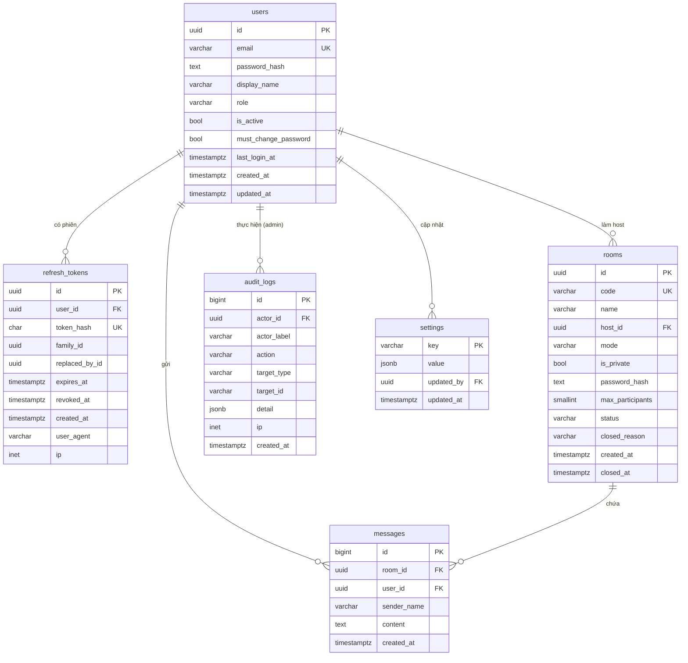

# 01. Database

> PostgreSQL 16, SQLAlchemy 2.0 async, Alembic.
> Tài liệu này mô tả **trạng thái cuối cùng** của schema. Khi code, bảng được tạo dần theo từng migration (mục 6).

## 1. Quy ước

| Hạng mục | Quy ước |
|---|---|
| Tên bảng | Số nhiều, `snake_case`: `users`, `refresh_tokens` |
| Khóa chính | `uuid`, sinh ở DB bằng `gen_random_uuid()` (có sẵn từ PostgreSQL 13). **Ngoại lệ:** `audit_logs` và `messages` dùng `bigint identity` vì cần thứ tự và phân trang theo con trỏ |
| Thời gian | Luôn `timestamptz` (UTC). Không dùng `timestamp` thường |
| Cột chung | `id`, `created_at` (default `now()`); thêm `updated_at` nếu bảng có sửa |
| Chuỗi enum | `varchar` + `CHECK`, **không dùng PostgreSQL ENUM** (thêm giá trị rất khó migrate) |
| Email | Lưu chữ thường; unique index trên `lower(email)` làm lớp bảo vệ thứ hai |
| Xóa | Xóa cứng, quan hệ xử lý bằng `ON DELETE` (xem từng bảng) |

### Naming convention (đặt ngay từ A1 trong `Base.metadata`)

```python
convention = {
    "ix": "ix_%(column_0_label)s",
    "uq": "uq_%(table_name)s_%(column_0_name)s",
    "ck": "ck_%(table_name)s_%(constraint_name)s",
    "fk": "fk_%(table_name)s_%(column_0_name)s_%(referred_table_name)s",
    "pk": "pk_%(table_name)s",
}
```

Nhờ vậy tên constraint ổn định giữa các máy và Alembic không sinh tên ngẫu nhiên.

## 2. ERD



**Không có trong DB** (chỉ nằm trong bộ nhớ hoặc JWT):
- Khách (guest): chỉ có JWT, không có dòng nào.
- Ai đang online, ai đang ở phòng nào: trạng thái realtime trong RAM (xem `03-socket-events.md`).

## 3. Chi tiết từng bảng

### 3.1 `users`

| Cột | Kiểu | Ràng buộc | Ghi chú |
|---|---|---|---|
| `id` | uuid | PK | |
| `email` | varchar(254) | NOT NULL | Đã chuyển lowercase ở tầng service |
| `password_hash` | text | NOT NULL | Hash argon2id, không bao giờ trả ra API |
| `display_name` | varchar(50) | NOT NULL | 2-50 ký tự |
| `birth_date` | date | NULL, CHECK >= 1900-01-01 | E1 (`0009`); service kiểm tra không ở tương lai, không quá 120 năm |
| `avatar_key` | varchar(80) | NULL | Hash SHA-256 của hai ảnh WebP đã xử lý; không lưu tên tệp người dùng |
| `avatar_updated_at` | timestamptz | NULL | Thời điểm thay ảnh |
| `discoverable_by_email` / `show_online_status` | boolean | NOT NULL, default `true` | E1 lưu lựa chọn; E2/E3 sẽ dùng khi tìm bạn/hiển thị online |
| `role` | varchar(16) | NOT NULL, default `'user'`, CHECK in (`user`,`admin`) | Thêm ở `0003` |
| `is_active` | boolean | NOT NULL, default `true` | `false` = bị khóa. Thêm ở `0003` |
| `must_change_password` | boolean | NOT NULL, default `false` | `true` sau khi admin reset mật khẩu. Thêm ở `0003` |
| `last_login_at` | timestamptz | NULL | Thêm ở `0003` |
| `created_at` / `updated_at` | timestamptz | NOT NULL, default `now()` | |

Index:
- `uq_users_email_lower`: UNIQUE trên `lower(email)`
- `ix_users_role`: (`role`), phục vụ đếm admin và lọc
- `ix_users_created_at`: (`created_at`), phục vụ thống kê user mới theo ngày

Tìm kiếm admin (`?q=`) dùng `ILIKE` trên `email` và `display_name`. Với quy mô đồ án, quét bảng là đủ. Nếu chậm thì thêm extension `pg_trgm` và index GIN.

### 3.2 `refresh_tokens`

| Cột | Kiểu | Ràng buộc | Ghi chú |
|---|---|---|---|
| `id` | uuid | PK | |
| `user_id` | uuid | NOT NULL, FK → `users.id` **ON DELETE CASCADE** | |
| `token_hash` | char(64) | NOT NULL, UNIQUE | SHA-256 dạng hex của token gốc. Token gốc là 32 byte ngẫu nhiên nên SHA-256 là đủ, không cần argon2 |
| `family_id` | uuid | NOT NULL | Mọi token sinh ra từ cùng một lần đăng nhập chung `family_id` |
| `replaced_by_id` | uuid | NULL, FK → `refresh_tokens.id` ON DELETE SET NULL | Trỏ tới token mới khi xoay vòng |
| `expires_at` | timestamptz | NOT NULL | |
| `revoked_at` | timestamptz | NULL | `NULL` = còn hiệu lực |
| `created_at` | timestamptz | NOT NULL | |
| `user_agent` | varchar(255) | NULL | Hiển thị "thiết bị" cho người dùng/admin |
| `ip` | inet | NULL | |

Index: `ix_refresh_tokens_user_id` (`user_id`), `ix_refresh_tokens_family_id` (`family_id`), `ix_refresh_tokens_expires_at` (cho job dọn dẹp).

Quy tắc xoay vòng và phát hiện dùng lại token: xem `02-api.md` mục 1.3.

Dọn dẹp: job định kỳ xóa các dòng `expires_at < now() - interval '30 days'`.

### 3.3 `rooms`

| Cột | Kiểu | Ràng buộc | Ghi chú |
|---|---|---|---|
| `id` | uuid | PK | |
| `code` | varchar(12) | NOT NULL, UNIQUE | Dạng `abc-defg-hij` (10 chữ cái + 2 dấu gạch), sinh bằng `secrets`, bỏ ký tự dễ nhầm (`i`, `l`, `o`) |
| `name` | varchar(100) | NULL | |
| `host_id` | uuid | NULL, FK → `users.id` **ON DELETE SET NULL** | Chủ phòng ("owner"). Khách không tạo được phòng nên luôn có giá trị lúc tạo |
| `mode` | varchar(16) | NOT NULL, default `'meeting'`, CHECK in (`meeting`,`livestream`) | `livestream` cần SFU (giai đoạn A10) |
| `is_private` | boolean | NOT NULL, default `false` | `true` = cần mật khẩu để vào |
| `password_hash` | text | NULL | argon2id |
| `max_participants` | smallint | NULL | `NULL` = dùng `max_participants_per_room` trong settings |
| `status` | varchar(16) | NOT NULL, default `'active'`, CHECK in (`active`,`closed`) | |
| `closed_reason` | varchar(32) | NULL | `host`, `admin`, `empty_timeout`, `owner_deleted` |
| `created_at` | timestamptz | NOT NULL | |
| `closed_at` | timestamptz | NULL | |

Ràng buộc:
- `ck_rooms_private_has_password`: `is_private = (password_hash IS NOT NULL)`
- `ck_rooms_closed_consistent`: `(status = 'closed') = (closed_at IS NOT NULL)`
- `ck_rooms_max_participants`: `max_participants IS NULL OR max_participants BETWEEN 2 AND 50`

Index:
- `uq_rooms_code` (UNIQUE)
- `ix_rooms_host_active`: (`host_id`) `WHERE status = 'active'`, phục vụ đếm `max_rooms_per_user`
- `ix_rooms_status_created_at`: (`status`, `created_at`)

Vòng đời: `active` → `closed` (khi host đóng, admin đóng, hoặc phòng trống quá `room_empty_ttl_seconds`). Phòng đã đóng không mở lại; muốn họp tiếp thì tạo phòng mới.

### 3.4 `messages`

| Cột | Kiểu | Ràng buộc | Ghi chú |
|---|---|---|---|
| `id` | bigint | PK, identity | Dùng làm con trỏ phân trang (`?before=<id>`) |
| `room_id` | uuid | NOT NULL, FK → `rooms.id` **ON DELETE CASCADE** | |
| `user_id` | uuid | NULL, FK → `users.id` **ON DELETE SET NULL** | `NULL` với khách hoặc user đã bị xóa |
| `sender_name` | varchar(50) | NOT NULL | Chụp lại tên lúc gửi, để hiển thị đúng dù user đổi tên hay bị xóa |
| `content` | text | NOT NULL, CHECK `char_length(content) BETWEEN 1 AND 2000` | |
| `created_at` | timestamptz | NOT NULL | |

Index: `ix_messages_room_id_id` (`room_id`, `id` DESC).

Server lấy ID từ sequence để sự kiện realtime và lịch sử dùng cùng một mã tin nhắn. Server broadcast trước, sau đó ghi tin nhắn vào DB bằng tác vụ nền. Job xóa tin nhắn của phòng đã đóng quá `chat_retention_days` ngày nằm trong kế hoạch vận hành.

### 3.5 `settings`

| Cột | Kiểu | Ràng buộc | Ghi chú |
|---|---|---|---|
| `key` | varchar(64) | PK | Khóa cấu hình, ví dụ `allow_guest` |
| `value` | jsonb | NOT NULL | Giá trị đã được validate bằng Pydantic |
| `updated_by` | uuid | NULL, FK → `users.id` ON DELETE SET NULL | |
| `updated_at` | timestamptz | NOT NULL | |

**Chỉ lưu giá trị bị admin ghi đè.** Giá trị mặc định nằm trong code. Reset về mặc định = xóa dòng. Thêm một cấu hình mới **không cần migration** (xem `04-settings.md`).

### 3.6 `audit_logs`

| Cột | Kiểu | Ràng buộc | Ghi chú |
|---|---|---|---|
| `id` | bigint | PK, identity | |
| `actor_id` | uuid | NULL, FK → `users.id` ON DELETE SET NULL | Admin thực hiện |
| `actor_label` | varchar(254) | NOT NULL | Chụp lại email admin lúc thực hiện, vì `actor_id` có thể thành NULL sau này |
| `action` | varchar(64) | NOT NULL | Ví dụ `user.lock`, `settings.update` |
| `target_type` | varchar(32) | NULL | `user`, `room`, `settings` |
| `target_id` | varchar(64) | NULL | `varchar` vì có thể là uuid hoặc room code |
| `detail` | jsonb | NOT NULL, default `'{}'` | Giá trị trước/sau. **Không bao giờ chứa mật khẩu, token, secret** |
| `ip` | inet | NULL | |
| `created_at` | timestamptz | NOT NULL | |

Index: `ix_audit_logs_created_at` (`created_at` DESC), `ix_audit_logs_actor_id_created_at`, `ix_audit_logs_action_created_at`.

Bảng này **chỉ thêm, không sửa, không xóa** từ ứng dụng. Nên cấp riêng cho role DB của app quyền `INSERT, SELECT` trên bảng này (không cấp `UPDATE/DELETE`) nếu muốn làm chặt hơn.

Danh sách `action`: xem `02-api.md` mục 8.

## 4. Quan hệ và hành vi khi xóa user

| Bảng con | FK | Khi xóa user |
|---|---|---|
| `refresh_tokens` | `user_id` | CASCADE: xóa hết phiên |
| `rooms` | `host_id` | SET NULL; service **đóng trước** các phòng đang `active` của user (`closed_reason = 'owner_deleted'`) |
| `messages` | `user_id` | SET NULL (giữ tin nhắn nhờ `sender_name`) |
| `audit_logs` | `actor_id` | SET NULL (giữ nhật ký nhờ `actor_label`) |
| `settings` | `updated_by` | SET NULL |

## 5. Truy vấn chính và index tương ứng

| Truy vấn | Index dùng |
|---|---|
| Đăng nhập theo email | `uq_users_email_lower` |
| Xác thực refresh token | `uq_refresh_tokens_token_hash` |
| Thu hồi mọi phiên của user | `ix_refresh_tokens_user_id` |
| Thu hồi cả family khi phát hiện dùng lại | `ix_refresh_tokens_family_id` |
| Tìm phòng theo mã | `uq_rooms_code` |
| Đếm phòng đang mở của user | `ix_rooms_host_active` |
| Lịch sử chat của phòng | `ix_messages_room_id_id` |
| Xem audit log theo thời gian / admin / hành động | 3 index của `audit_logs` |
| Admin: user mới theo ngày | `ix_users_created_at` |

## 6. Kế hoạch migration (tạo dần)

| Rev | Tên | Nội dung | Bước | Lưu ý |
|---|---|---|---|---|
| `0000` | `baseline` | Rỗng hoặc bật extension cần thiết | A1 | |
| `0001` | `create_users` | Bảng `users` (chỉ `id`, `email`, `password_hash`, `display_name`, `created_at`, `updated_at`) + `uq_users_email_lower` | A2 | Index trên `lower(email)` Alembic không tự sinh đúng, **phải viết tay** |
| `0002` | `create_refresh_tokens` | Bảng `refresh_tokens` | A2 | |
| `0003` | `add_user_admin_columns` | Thêm `role`, `is_active`, `must_change_password`, `last_login_at` + CHECK + `ix_users_role` | A3 | Thêm cột NOT NULL vào bảng đã có dữ liệu → **bắt buộc `server_default`** |
| `0004` | `create_settings` | Bảng `settings` | A3 | |
| `0005` | `create_audit_logs` | Bảng `audit_logs` + index | A3 | |
| `0006` | `create_rooms` | Bảng `rooms` + ràng buộc + index | A4 | |
| `0007` | `create_messages` | Bảng `messages` + index | A8 | |
| `0008` | `device_transfers` | Phân loại phiên và xác nhận chuyển thiết bị | V2 | Đã triển khai, không sửa lại |
| `0009` | `add_user_profile` | Hồ sơ, avatar và hai quyền riêng tư | V3 E1 | Cột mới có NULL/default, giữ nguyên dữ liệu cũ |
| `0010` | `create_friends` | `friend_requests`, `friendships`, `user_blocks` | V3 E2 | FK CASCADE; cặp bạn bè chuẩn hóa, unique lời mời đang chờ |

V3 E2 thêm ba bảng, chi tiết tại [`extend.md` mục 3.3](../docs_v3/extend.md#33-friend_requests-và-friendships-migration-0010):

- `friend_requests`: UUID; người gửi/nhận FK `users`, khác nhau; status `pending/accepted/declined/cancelled/expired`; `created_at`, `responded_at`. Unique một phần `(from_user_id,to_user_id) WHERE status='pending'`; index theo người gửi/nhận và status.
- `friendships`: PK `(user_a_id,user_b_id)`, CHECK `a < b`, thời điểm tạo; index riêng `user_b_id`. Service khóa hai tài khoản theo thứ tự UUID trước khi kiểm tra hạn mức và ghi để tránh race.
- `user_blocks`: PK `(blocker_id,blocked_id)`, CHECK khác nhau, thời điểm tạo; index `blocked_id`. Chặn một chiều, tìm kiếm/gửi lời mời kiểm tra cả hai chiều.

App có quyền SELECT/INSERT/UPDATE/DELETE trên ba bảng; migration cấp quyền cho `POSTGRES_APP_USER`. Khi xóa tài khoản, dữ liệu liên quan được CASCADE. Không thêm bảng DM/lời mời gọi trong E2/E3.

Quy tắc (nhắc lại từ phần phân tích):
1. Mỗi migration làm một việc nhỏ, tên rõ ràng.
2. **Đọc lại file autogenerate** trước khi chạy: Alembic không nhận ra đổi tên cột và bỏ sót một số default/constraint.
3. Không sửa migration đã commit; muốn đổi thì tạo migration mới.
4. Viết `downgrade()` và thử: `upgrade head` → `downgrade -1` → `upgrade head`.
5. Dùng `alembic init -t async migrations`.
6. CI chạy `alembic upgrade head` trên Postgres thật rồi `alembic check` để bắt lỗi quên tạo migration.
7. Viết migration **tương thích ngược** (thêm cột có default thay vì đổi tên/xóa ngay) để rollback code không làm hỏng DB. Xem `05-deployment.md` mục rollback.

## 7. Bảo mật và vận hành DB

- App dùng **role DB riêng** (`videocall_app`), không dùng superuser. Migration chạy bằng role có quyền DDL.
- Postgres **không publish cổng ra ngoài** trong production; chỉ container `app` và `migrate` truy cập được qua mạng nội bộ Docker.
- Backup: `pg_dump` hằng ngày + trước mỗi lần deploy có migration; giữ 7 bản; thử restore định kỳ (xem `05-deployment.md`).
- Kết nối: pool async (`pool_size` 5-10), `pool_pre_ping=True`.
- Timezone: để server DB ở UTC; mọi chuyển đổi múi giờ làm ở client.

## 8. Dữ liệu khởi tạo (seed)

- **Không seed bằng migration.**
- Admin đầu tiên tạo bằng CLI: `python -m app.cli create-admin --email ... ` (nhập mật khẩu qua prompt, không truyền trên dòng lệnh để khỏi lọt vào shell history). Có từ bước A3.
- `settings` rỗng lúc đầu = dùng toàn bộ giá trị mặc định.
