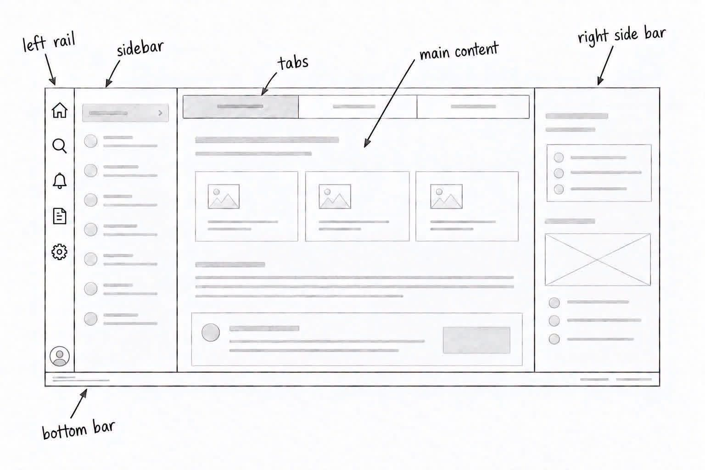

# Video Call / Livestream: Tài liệu thiết kế

> **Trạng thái:** bản nháp v0.1, chờ review. Chưa có dòng code nào.
> **Công nghệ chính:** Python (FastAPI, python-socketio, aiortc), PostgreSQL, coturn, Docker, Caddy.
> **Định hướng:** backend + devops. Client chỉ là JS thuần tối giản để kiểm tra backend.

> **Cập nhật V3 (21/11/2026).** Giai đoạn 2 đã triển khai E1–E7. Xem [hướng dẫn nghiệm thu](../docs_v3/phase2-completion.md).

## 1. Mục lục

| File | Nội dung | Đọc khi nào |
|---|---|---|
| [`01-database.md`](01-database.md) | ERD, chi tiết từng bảng, index, ràng buộc, kế hoạch migration | Trước khi viết model |
| [`02-api.md`](02-api.md) | Toàn bộ endpoint HTTP, request/response mẫu, mã lỗi, rate limit | Trước khi viết `api/` |
| [`03-socket-events.md`](03-socket-events.md) | Sự kiện Socket.io, luồng signaling, phân quyền host, xử lý lỗi | Trước khi viết `realtime/` (**cốt lõi**) |
| [`04-settings.md`](04-settings.md) | Cấu hình vận hành sửa được từ trang admin | Trước khi viết `settings_service` |
| [`05-deployment.md`](05-deployment.md) | Docker, mạng, cổng, coturn, Caddy, CI/CD, giám sát, load test | Trước khi vào giai đoạn B |
| [`06-decisions.md`](06-decisions.md) | Các quyết định kiến trúc và lý do, câu hỏi còn mở | Khi viết báo cáo |

## 2. Phạm vi

### 2.1 MVP (bắt buộc)
- Đăng ký / đăng nhập / khách (guest), JWT + refresh token xoay vòng
- Tạo phòng, vào phòng bằng mã (có thể đặt mật khẩu phòng)
- Gọi video 1-1 và nhóm nhỏ (mesh, tối đa 4 người)
- Bật/tắt mic, camera; chia sẻ màn hình; chat realtime
- TURN credential tạm thời, chỉ cấp cho người đã xác thực
- Trang admin: quản lý tài khoản, phòng, cấu hình, audit log

### 2.2 Mở rộng (nếu còn thời gian)
- SFU bằng aiortc cho nhóm đông và livestream 1-nhiều (`mode = livestream`)
- Chỉ số mạng realtime trên giao diện (RTT, packet loss, bitrate)
- Giơ tay, kick/mute bởi host, ghi hình phòng
- Chuyển trạng thái phòng sang Redis, chạy nhiều instance

### 2.3 Ngoài phạm vi
Đăng nhập OAuth, quên mật khẩu qua email, 2FA, simulcast/SVC.

## 3. Mục tiêu phi chức năng

| Mục tiêu | Chỉ tiêu | Cách đo |
|---|---|---|
| Độ trễ media | **< 200 ms** một chiều (không thể đạt "0") | `getStats()`: `currentRoundTripTime / 2`, kết hợp đo thủ công |
| Mất gói | < 2% trong điều kiện mạng bình thường | `getStats()`: `packetsLost` |
| Kết nối khác mạng | Thành công kể cả khi NAT đối xứng (qua TURN) | Test 4G ↔ Wi-Fi |
| Bảo mật | Không lưu mật khẩu thô; token thu hồi được; secret không nằm trong git | Review + test |
| Vận hành | Deploy bằng 1 lệnh, rollback được, có giám sát và backup | CI/CD, Grafana |
| Chất lượng code | Test tự động cho service, API, socket; CI xanh mới merge | GitHub Actions |

## 4. Kiến trúc tổng quan

```
                         Internet
                            │
        ┌───────────────────┼─────────────────────┐
        │ 443/tcp           │ 3478/udp+tcp        │ 49152-49252/udp
        ▼                   ▼  (STUN/TURN)        ▼  (TURN relay)
   ┌─────────┐         ┌─────────┐
   │  Caddy  │         │ coturn  │
   │ (HTTPS) │         └─────────┘
   └────┬────┘
        │ HTTP + WebSocket
        ▼
   ┌──────────────────────────────┐        ┌────────────┐
   │ app (FastAPI + Socket.io)    │───────▶│ PostgreSQL │
   │  api/ ─┐                     │        └────────────┘
   │        ├─▶ services/ ─▶ db   │
   │ realtime/┘   │               │        ┌────────────┐
   │              └─▶ state (RAM) │        │ Prometheus │◀── /metrics
   └──────────────────────────────┘        │  + Grafana │
                                           └────────────┘

   Trình duyệt A ◀══════ media (SRTP, P2P hoặc qua TURN) ══════▶ Trình duyệt B
```

Server **chỉ trung chuyển tín hiệu (signaling)**. Media đi thẳng giữa các trình duyệt, hoặc qua TURN khi P2P không thông, hoặc qua SFU ở giai đoạn sau.

### 4.1 Web Videocall, ứng dụng mobile và trang quản trị

Giao diện quản trị tại `/admin` tách biệt với web Videocall và dành cho tài khoản có quyền quản trị. Trang này quản lý người dùng, phòng, cấu hình và nhật ký hoạt động trên cùng hệ thống.

Giai đoạn V2 tập trung thiết kế lại giao diện web người dùng và quản trị. Điện thoại dùng web trên trình duyệt để kiểm thử. App React Native được lưu cho đợt phát triển sau, dùng chung backend, tài khoản và mã phòng. [Kế hoạch tiếp tục app](../docs_v2/08-app-mobile-sau-nay.md)

- **Dùng chung tài khoản và phòng.** Tài khoản tạo trên web đăng nhập được trên app. Người dùng trên laptop có thể tạo phòng, rồi người dùng trên điện thoại nhập cùng mã phòng để gọi hoặc xem livestream.
- **Dùng chung máy chủ.** Web và app kết nối tới cùng API, dùng các sự kiện Socket.IO hiện có để báo hiệu WebRTC và dùng chung TURN/SFU. Trang quản trị web quản lý người dùng và phòng của cả hai giao diện.
- **Dùng chung repo GitHub.** Mã nguồn React Native có thể đặt trong thư mục `mobile/` của repo Videocall. Android và iOS có bản cài riêng, còn backend và dữ liệu vẫn dùng chung.

## 5. Công nghệ

| Phần | Lựa chọn |
|---|---|
| Web framework | FastAPI (async), Uvicorn |
| Realtime | python-socketio (AsyncServer, mount vào ASGI) |
| Media server (giai đoạn sau) | aiortc |
| ORM / migration | SQLAlchemy 2.0 async + Alembic (template async) |
| Database | PostgreSQL 16 |
| Mật khẩu / JWT | argon2 (`pwdlib`) / PyJWT |
| Rate limit | slowapi (bộ nhớ) → Redis nếu cần |
| Admin web | Jinja2 + HTMX |
| Client | HTML + JS thuần (WebRTC API) |
| Reverse proxy | Caddy (HTTPS tự động) |
| STUN/TURN | coturn |
| Giám sát | Prometheus + Grafana, log JSON |
| CI/CD | GitHub Actions, GHCR, deploy qua SSH |
| Test | pytest, pytest-asyncio, httpx, python-socketio client |

Ghi chú: **WebRTC trong trình duyệt bắt buộc dùng JavaScript** (camera, mic, `RTCPeerConnection`). Python đảm nhiệm toàn bộ backend, signaling và (sau này) SFU.

## 6. Lộ trình

### Giai đoạn A: Xây dựng

| Bước | Nội dung | Migration | Tài liệu |
|---|---|---|---|
| A1 | Khung dự án: FastAPI + Postgres + Compose, `/health`, `/ready`, Alembic | baseline | 05, 06 |
| A2 | Auth: register, login, refresh, logout, guest, `/me` | `0001 users`, `0002 refresh_tokens` | 01, 02 |
| A3 | Admin API: user, settings, audit log; **CLI `create-admin`** | `0003 users_admin_cols`, `0004 settings`, `0005 audit_logs` | 02, 04 |
| A4 | Rooms + signaling có xác thực, áp dụng settings, kick, đóng phòng | `0006 rooms` | 02, 03 |
| A5 | Client tối giản: login, lobby, gọi 1-1 | | 03 |
| A6 | Trang admin (Jinja2 + HTMX) | | 02 |
| A7 | coturn + `/turn-credentials` | | 02, 05 |
| A8 | Chat (lưu lịch sử), chia sẻ màn hình, mute/camera | `0007 messages` | 03 |
| A9 | Mesh nhiều người | | 03 |
| A10 | SFU + livestream | (có thể thêm cột/bảng) | 03 |
| A11 | Metrics (`/metrics`), log có cấu trúc | | 05 |

> **Điều chỉnh so với các trao đổi trước:** lệnh CLI `create-admin` chuyển từ A2 sang A3, vì cột `role` chỉ được thêm ở migration `0003`.

### Giai đoạn B: Deploy / DevOps

| Bước | Nội dung |
|---|---|
| B1 | VPS, domain, firewall |
| B2 | Caddy + HTTPS, WebSocket qua proxy, khóa `/admin` |
| B3 | coturn production (secret, giới hạn cổng, chặn dải IP nội bộ) |
| B4 | CI/CD GitHub Actions: test → build → push → deploy → rollback |
| B5 | Prometheus + Grafana + cảnh báo |
| B6 | Load test bằng bot aiortc, đo giới hạn |
| B7 | Báo cáo: sơ đồ, số liệu, bài học |

### Giai đoạn V2

#### Ứng dụng mobile React Native

Tạm hoãn từ ngày 18/11/2026. Các mục dưới đây được giữ làm kế hoạch cho đợt phát triển app sau. [Phạm vi V2 hiện tại](../docs_v2/01-pham-vi.md)

Bổ sung ứng dụng React Native cho Android và iOS theo [kiến trúc dùng chung backend](#41-web-videocall-ứng-dụng-mobile-và-trang-quản-trị).

1. Tạo ứng dụng trong thư mục `mobile/` và cho phép đăng ký, đăng nhập ngay trên app qua API xác thực dùng chung. Tài khoản tạo trên app cũng đăng nhập được trên web. App tuân theo cấu hình cho phép đăng ký của quản trị viên.
2. Cho phép app nhập mã phòng để gọi video hoặc xem livestream cùng người dùng web.
3. Kiểm thử cuộc gọi web ↔ mobile để xác nhận cả hai bên nhận được tiếng và hình. Kiểm thử thêm luồng phát từ web và xem trên app.

#### Thiết kế lại web người dùng



- Dùng thanh biểu tượng sát mé trái cho điều hướng chính và thanh bên trái cho danh sách phòng. Các tab phía trên chuyển giữa những nội dung liên quan.
- Dành vùng chính cho lobby, cuộc gọi hoặc livestream. Thanh bên phải hiển thị thông tin theo ngữ cảnh, chẳng hạn danh sách thành viên và chat trong phòng. Thanh dưới hiển thị trạng thái kết nối khi đang gọi.
- Trên màn hình hẹp, cho phép thu gọn các thanh bên để ưu tiên nội dung chính và nút điều khiển cuộc gọi.

#### Giao diện sáng và tối

Web người dùng trên máy tính/điện thoại và trang quản trị có tùy chọn **Sáng** và **Tối**. Lưu lựa chọn trên từng trình duyệt để áp dụng ở lần mở tiếp theo. App sẽ tiếp tục tính năng này trong đợt phát triển sau.

#### Thiết kế lại web quản trị

Trang `/admin` dùng bố cục tương tự hình mẫu, với bảng màu, tiêu đề và menu riêng để dễ phân biệt với web người dùng. Menu quản trị gồm Dashboard, tài khoản, phòng, cấu hình và nhật ký.

Tab **Dashboard** tự cập nhật tại chỗ hai chỉ số theo thời gian thực.

- **Số phòng đang hoạt động** đếm các phòng có ít nhất một người đang ở trong phòng.
- **Số tài khoản đang hoạt động** đếm các tài khoản đã đăng nhập có kết nối realtime. Mỗi tài khoản tính một lần, kể cả khi mở nhiều tab trong cùng phiên.

Kiểm thử Dashboard khi người đầu tiên vào hoặc người cuối cùng rời phòng. Kiểm tra thêm một tài khoản mở nhiều tab vẫn được tính một lần và rời bộ đếm khi mất kết nối cuối cùng.

#### Tài khoản và cấu hình quản trị

- Bản demo cục bộ có tài khoản quản trị cố định `admin` với mật khẩu `admin123`, đăng nhập tại `/admin`. Bản triển khai có người dùng thật dùng mật khẩu quản trị mạnh, riêng cho từng môi trường.
- Trong tab **Cấu hình**, quản trị viên có thể đổi tên hiển thị của dự án, màu chủ đạo và phông chữ trên web người dùng và app.
- Quản trị viên có thể khóa và mở lại từng chức năng để bảo trì. Backend áp dụng trạng thái khóa cho cả web và app. Giao diện hiển thị thông báo bảo trì, và quản trị viên vẫn truy cập được trang cấu hình để mở lại chức năng.

#### Giới hạn đăng nhập trên một thiết bị

Mỗi tài khoản người dùng có tối đa một phiên thiết bị. Các tab dùng chung phiên trình duyệt được tính là một phiên. Quy tắc áp dụng cho cả web và app mobile.

Khi thông tin đăng nhập trên thiết bị mới hợp lệ và thiết bị cũ còn phiên, thiết bị mới hiển thị lựa chọn **Chuyển sang thiết bị này** hoặc **Hủy**.

- **Xác nhận chuyển.** Backend thông báo cho thiết bị cũ, thu hồi phiên và ngắt kết nối realtime ở đó, rồi cấp phiên đăng nhập cho thiết bị mới.
- **Hủy.** Thiết bị mới trở về màn hình đăng nhập. Thiết bị cũ giữ phiên và tiếp tục cuộc gọi nếu đang gọi.

Kiểm thử cả xác nhận và hủy trong lúc gọi, cùng trường hợp hai lượt đăng nhập đến gần như đồng thời. Máy chủ chỉ duy trì tối đa một phiên thiết bị hợp lệ.

## 7. Quy ước chung của dự án

- **Ngôn ngữ:** code, tên biến, tên bảng bằng tiếng Anh; tài liệu và comment giải thích bằng tiếng Việt.
- **Phân tầng:** `api/` và `realtime/` → `services/` → `models/` + `db/`. Handler không chứa logic nghiệp vụ.
- **Định danh:** UUID; thời gian `timestamptz` (UTC); JSON dùng `snake_case`.
- **Git:** nhánh `main` luôn chạy được; làm theo nhánh `feat/...`; commit theo dạng `feat:`, `fix:`, `docs:`, `chore:`.
- **Tài liệu là bản sống:** sửa code mà đổi thiết kế thì sửa docs trong cùng commit.
- **Bí mật** chỉ nằm trong biến môi trường (`.env` không commit; `.env.example` thì commit).

## 8. Thuật ngữ

| Từ | Nghĩa |
|---|---|
| **WebRTC** | Bộ API của trình duyệt để truyền audio/video/dữ liệu realtime |
| **Signaling** | Việc trao đổi thông tin kết nối (SDP, ICE) giữa hai bên trước khi có media; WebRTC không quy định cách làm, ta dùng Socket.io |
| **SDP** | Văn bản mô tả phiên media (codec, địa chỉ, khóa mã hóa); có 2 loại: offer và answer |
| **ICE candidate** | Một địa chỉ (IP:port) có thể dùng để kết nối |
| **STUN** | Máy chủ giúp client biết IP:port công khai của mình |
| **TURN** | Máy chủ chuyển tiếp media khi hai bên không kết nối trực tiếp được (NAT đối xứng, tường lửa) |
| **Mesh** | Mỗi người nối trực tiếp với mọi người khác; N người thì mỗi máy upload N-1 luồng |
| **SFU** | Server nhận 1 luồng từ mỗi người rồi chuyển tiếp cho người khác, không giải mã |
| **Host / owner** | Chủ phòng: người tạo phòng, có quyền kick, mute, đóng phòng |

## 9. Checklist review dành cho bạn

Đọc theo thứ tự `06 → 02 → 03 → 01 → 04 → 05` và đánh dấu:

- [ ] Phạm vi MVP và mở rộng ở mục 2 đã đúng ý?
- [ ] Các quyết định ở `06-decisions.md` mục "Câu hỏi còn mở" cần bạn chốt (có đánh dấu **[CẦN CHỐT]**)
- [ ] Danh sách endpoint (`02`) có thiếu hoặc thừa không?
- [ ] Danh sách sự kiện socket (`03`) và quyền host có hợp lý không?
- [ ] Các bảng và cột (`01`) có thiếu trường nào bạn cần không?
- [ ] Danh sách cấu hình (`04`) có muốn thêm/bớt cấu hình nào không?
- [ ] Sơ đồ cổng và container (`05`) có khớp với VPS bạn định thuê không?
