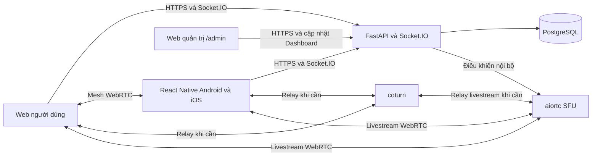

# 02 · Kiến trúc và công nghệ

[Mục lục V2](README.md)

Phần React Native được lưu cho đợt phát triển app sau. Hiện điện thoại dùng web trên trình duyệt. [Quyết định phạm vi](08-app-mobile-sau-nay.md)

## 1. Kiến trúc tổng quan

API và Socket.IO dùng chung trên cả hai giao diện người dùng. Cuộc gọi nhóm trao đổi media trực tiếp khi ICE chọn được đường truyền, hoặc đi qua TURN khi cần. Livestream tiếp tục đi qua worker SFU. Trang quản trị dùng backend và dữ liệu chung nhưng có tuyến, bố cục và quyền truy cập riêng.

## 2. Công nghệ và phần dùng lại

| Thành phần | V2 | Nền V1 |
|---|---|---|
| API, dữ liệu và migration | FastAPI, PostgreSQL, SQLAlchemy async, Alembic | Xác thực, phòng, cấu hình, nhật ký; schema ở `0007` |
| Web người dùng | HTML, CSS và JavaScript hiện có; tổ chức lại bố cục và CSS theo chủ đề | Trang đăng nhập, lobby, phòng và mã xử lý WebRTC |
| Web quản trị | Jinja2, HTMX và CSS riêng; đề xuất SSE cùng origin để cập nhật hai bộ đếm | Cookie quản trị, CSRF, quyền admin, Dashboard, cấu hình và audit |
| Mobile | React Native với TypeScript, Expo development build, `react-native-webrtc`, Socket.IO client và SecureStore | API đăng ký/đăng nhập/phòng, sự kiện báo hiệu và TURN credential hiện có |
| Kết nối media | coturn cho STUN/TURN, aiortc cho SFU, VP8 cho video livestream | A7–A10 |
| Vận hành | Docker Compose, Caddy cho HTTPS, GitHub Actions, Prometheus và log JSON | Compose, workflow Backend CI, readiness, metrics và `X-Request-ID` |

Chốt phiên bản thư viện mobile sau bài thử trên thiết bị thật, rồi lưu lockfile đã kiểm chứng trong repo. [Expo development build](https://docs.expo.dev/develop/development-builds/introduction/) · [React Native WebRTC với Expo](https://react-native-webrtc.github.io/handbook/guides/extra-steps/expo.html) · [Expo SecureStore](https://docs.expo.dev/versions/latest/sdk/securestore/)

## 3. Dữ liệu và trách nhiệm

| Dữ liệu | Thiết kế đề xuất |
|---|---|
| Phiên tài khoản | Dùng lại `refresh_tokens.family_id` đại diện cho một phiên. Lưu phạm vi `user` hoặc `admin` theo luồng cấp phiên và giữ phạm vi đó khi xoay token. Các quyết định cấp/chuyển phiên và thao tác thu hồi hoặc xoay token cùng khóa bản ghi tài khoản trong DB. Kiểm tra họ phiên còn hoạt động tại API HTTP và Socket.IO. |
| Yêu cầu chuyển thiết bị | Thêm dữ liệu lưu mã xác nhận đã băm, tài khoản, họ phiên cũ cần thay, loại client và hạn dùng. Mã dùng một lần. Tiêu thụ mã và thay phiên trong cùng giao dịch. |
| Giao diện và bảo trì | Lưu tên hiển thị, màu, mã phông chữ và các trạng thái bảo trì qua dịch vụ settings hiện có. API công khai trả tập thuộc tính client cần dùng. Sáng/tối lưu cục bộ ở mỗi giao diện. |
| Hiện diện | Dùng `RoomStateStore` để tính phòng có người và tài khoản có socket. V2 giữ một worker ứng dụng khi trạng thái này còn trong RAM. |
| Mật khẩu quản trị | Lưu bản băm bằng cơ chế xác thực hiện có. Đề xuất một định danh đăng nhập demo riêng cho `/admin` để giữ API email cho web người dùng và app. |

V1 lưu trạng thái đăng nhập web trong `sessionStorage` theo tab. V2 đề xuất cookie refresh `HttpOnly`, `Secure`, `SameSite=Strict` giới hạn ở `/api/v1/auth`, để các tab cùng hồ sơ trình duyệt dùng chung một họ phiên. Web giữ access token trong bộ nhớ và điều phối refresh giữa các tab. Mobile giữ refresh token trong SecureStore và access token trong bộ nhớ. Cookie quản trị tiếp tục giới hạn ở `/admin`. [Client web V1](../../client/js/api.js) · [Quy tắc phiên](05-quy-tac.md#2-phiên-tài-khoản)

## 4. Chuyển từ V1

- V2 kế thừa tài khoản, mật khẩu đã băm, phòng, tin nhắn và cấu hình. Migration mới nối tiếp `0007`. Kiểm tra nâng cấp từ DB V1 đã có dữ liệu.
- Đề xuất yêu cầu người dùng và quản trị viên đăng nhập lại một lần khi triển khai V2. Phiên V1 chưa lưu phạm vi `user` hoặc `admin`; cấp lại phiên giúp thiết lập đúng phạm vi và áp dụng giới hạn một thiết bị từ đầu. Lên lịch và thông báo trước khi thu hồi.
- Giữ endpoint đăng ký và hợp đồng REST/Socket.IO của phòng V1. Thay đổi hợp đồng đăng nhập cần phát hành backend và web cùng đợt, rồi cập nhật đường dẫn server của bản cài mobile. [API V1](../docs/02-api.md) · [Socket.IO V1](../docs/03-socket-events.md)
