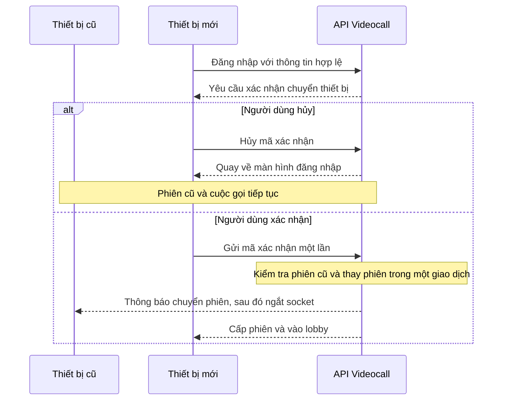

# 03 · Luồng người dùng và hợp đồng tích hợp

[Mục lục V2](README.md)

Các luồng app trong tài liệu này dùng làm tham chiếu cho đợt phát triển sau. Nghiệm thu hiện tại chạy web trên laptop và điện thoại. [Kế hoạch app](08-app-mobile-sau-nay.md)

Đường dẫn và sự kiện đã có dựa trên [API V1](../docs/02-api.md) và [Socket.IO V1](../docs/03-socket-events.md). Các phần đánh dấu **V2 đề xuất** cần được review trước khi viết mã.

## 1. Đăng ký và đăng nhập

1. Web hoặc app đọc `GET /api/v1/config/public` để hiển thị nhận diện, trạng thái đăng ký và thông báo bảo trì.
2. Đăng ký bằng email, tên hiển thị và mật khẩu qua `POST /api/v1/auth/register`. Backend kiểm tra cấu hình đăng ký và áp dụng xác thực giống nhau cho web và mobile. Khi đăng ký thành công, màn hình chuyển sang đăng nhập.
3. `POST /api/v1/auth/login` xác thực thông tin. Khi tài khoản chưa có phiên hợp lệ, backend cấp một phiên. Hồ sơ trình duyệt đã giữ đúng phiên có thể dùng refresh để mở thêm tab trong cùng phiên.
4. App giữ refresh token trong SecureStore. Web dùng cookie refresh theo [thiết kế lưu phiên](02-kien-truc.md#3-dữ-liệu-và-trách-nhiệm). Hai giao diện dùng access token để gọi API và xác thực Socket.IO.
5. Khi đăng xuất, gọi `POST /api/v1/auth/logout` để thu hồi phiên, xóa trạng thái xác thực của client và đóng kết nối. Khi khởi động lại, client thử refresh phiên; nếu phiên hết hạn hoặc đã bị thu hồi, trở về đăng nhập.

## 2. Chuyển thiết bị

Thiết bị mới chỉ thấy lựa chọn chuyển sau khi thông tin đăng nhập hợp lệ. Khi đã có phiên cũ, máy chủ cấp mã xác nhận ngắn hạn cho thiết bị mới. Trong thời gian chờ, thiết bị cũ tiếp tục sử dụng phiên hiện tại.

- **Xác nhận.** Khi giao dịch thành công, quyền HTTP và refresh của phiên cũ hết hiệu lực. Máy chủ gửi `force_disconnect` đến các socket của phiên cũ với lý do chuyển thiết bị, rồi ngắt kết nối. Web và app đóng media, xóa trạng thái đăng nhập và hiển thị thông báo. Thiết bị mới vào lobby và có thể nhập lại mã phòng.
- **Hủy.** Hủy mã xác nhận và trở lại màn hình đăng nhập trên thiết bị mới. Phiên cũ tiếp tục, kể cả khi đang gọi. Khi thiết bị mới đóng ứng dụng trước khi gửi yêu cầu hủy, mã tự hết hạn.
- **Đua hoặc quá hạn.** Mã xác nhận gắn với phiên cũ cụ thể. Nếu phiên đó đã đổi, hoặc mã đã dùng hoặc hết hạn, thiết bị mới quay lại đăng nhập để lấy trạng thái mới. Nếu máy cũ đang offline, lần kết nối hoặc refresh tiếp theo được xử lý như phiên đã hết hiệu lực.

### Hợp đồng V2 đề xuất

| Giao diện | Hành vi |
|---|---|
| `POST /api/v1/auth/login` | Giữ thông tin đăng nhập V1. Web gửi thêm `client_type: "web"` để nhận cookie refresh cùng origin; client JSON dùng hợp đồng token V1. `200` khi cấp phiên, hoặc `409 DEVICE_TRANSFER_REQUIRED` kèm `error.details.transfer_token` và `expires_at` khi xác thực thành công và phát hiện phiên thiết bị khác. |
| `POST /api/v1/auth/device-transfer/confirm` | Nhận `transfer_token`, phát hành phiên theo loại client đã lưu. `200` khi chuyển thành công. `409 DEVICE_TRANSFER_INVALID` khi mã không còn hợp lệ hoặc phiên cũ đã đổi. |
| `POST /api/v1/auth/device-transfer/cancel` | Nhận và hủy mã xác nhận. Trả `204`. Gửi lại yêu cầu hủy vẫn an toàn. |
| `POST /api/v1/auth/refresh` và API cần tài khoản | Phiên đã thu hồi bị từ chối với `401`. Trình duyệt dùng cookie refresh trong các tuyến xác thực; mobile gửi refresh token trong body. |
| Socket.IO `force_disconnect` | Dùng sự kiện V1 với lý do mới `DEVICE_SESSION_REPLACED` để hiển thị thông báo trên thiết bị cũ. |

## 3. Vào phòng gọi video

1. Một tài khoản tạo phòng bằng `POST /api/v1/rooms` và gửi mã cho người còn lại. Web hoặc app dùng mã để lấy thông tin phòng và đọc yêu cầu mật khẩu.
2. Client lấy ICE server qua `GET /api/v1/turn-credentials`, mở socket với access token rồi gửi `join_room`. Backend áp dụng giới hạn phòng và cấu hình bảo trì.
3. Trên máy được cấp quyền, client mở camera và mic khi người dùng chọn vào cuộc gọi. Mỗi cặp thiết bị trao đổi `offer`, `answer`, `ice_candidate` theo luật V1. Nếu candidate đến trước mô tả từ xa, giữ hàng đợi cho đến khi đặt xong mô tả. Kiểm tra cả tình huống hai bên cùng tạo offer.
4. Hiển thị trạng thái kết nối và đường trực tiếp hoặc TURN khi có thống kê. Khi rời phòng hoặc mất phiên, dừng camera/mic và đóng các kết nối media tương ứng. [Đàm phán mesh V1](../docs/03-socket-events.md#71-vào-phòng-và-thiết-lập-kết-nối-mesh)

## 4. Xem livestream trên app

1. Host mở phòng livestream trên web và bắt đầu phát theo luồng V1. Web gửi `offer` tới `sfu` với audio/video `sendonly`.
2. App nhập mã phòng, gửi `join_room` và đọc snapshot. App đợi `track_published` nếu phòng đang chờ người phát.
3. Người xem gửi `subscribe` với SDP `recvonly` và dùng answer từ SFU. Màn hình xin quyền camera/mic trong các luồng cần thu media; màn hình xem chỉ nhận stream.
4. Khi nguồn phát dừng hoặc đổi, app đóng kết nối xem cũ và cập nhật trạng thái; đăng ký lại khi nguồn mới phát. `unsubscribe` được dùng khi rời luồng xem. [Hợp đồng livestream V1](../docs/03-socket-events.md#9-sfu-và-livestream-a10)

## 5. Cấu hình và Dashboard

1. Admin lưu cấu hình qua phần settings hiện có. Backend kiểm tra dữ liệu, cập nhật cache và ghi audit. Web và app lấy cấu hình khi mở hoặc quay lại màn hình chính. Yêu cầu đến chức năng vừa bị khóa nhận kết quả bảo trì từ backend.
2. Dashboard tải số liệu ban đầu bằng HTTP. **V2 đề xuất** luồng SSE cùng origin tại `GET /admin/dashboard/events` dùng phiên quản trị và gửi ảnh chụp hai bộ đếm khi chúng đổi. Server kiểm tra phiên quản trị còn hợp lệ trong khi luồng mở. Khi trình duyệt kết nối lại, server gửi ảnh chụp hiện tại.
3. Payload SSE chỉ gồm `rooms_with_participants` và `online_accounts`. Tính cả hai từ hiện diện realtime theo [quy tắc đếm](05-quy-tac.md#5-hiện-diện-và-dashboard).
