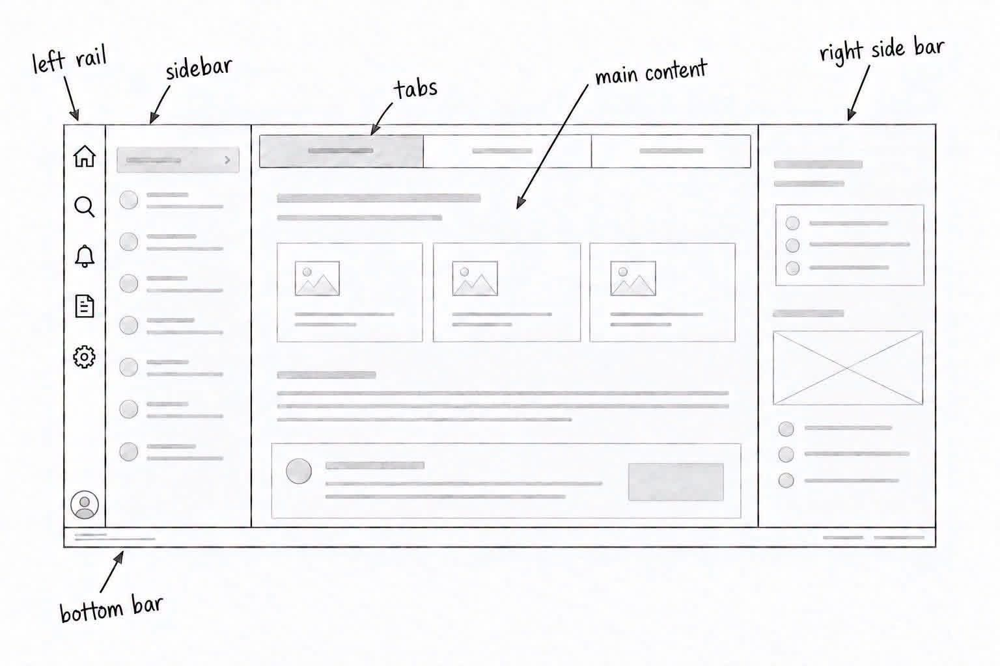

# 04 · Giao diện web, quản trị và mobile

[Mục lục V2](README.md)

## 1. Hình tham chiếu

## 2. Web người dùng

| Vùng trong hình | Vai trò ở Videocall |
|---|---|
| Thanh biểu tượng sát mé trái | Điều hướng giữa lobby, phòng của tôi và hồ sơ hoặc tùy chọn giao diện. |
| Thanh bên trái | Danh sách phòng của tài khoản. Lối vào tạo phòng hoặc nhập mã phòng nằm ở đầu danh sách. |
| Tab trên vùng chính | Chuyển giữa các phần có sẵn phù hợp màn hình, chẳng hạn Gọi nhóm và Livestream khi tạo phòng. |
| Vùng chính | Lobby hoặc lưới video/phát livestream. Giữ các nút mic, camera và rời phòng tại vị trí dễ thấy. |
| Thanh bên phải | Thành viên, chat và thông tin của phòng đang xem. |
| Thanh dưới | Trạng thái kết nối và thông tin cuộc gọi khi có phòng đang mở. |

Trên màn hình hẹp, cho phép thu gọn hai thanh bên và vẫn giữ các thao tác gọi trong tầm tay. Web tiếp tục dùng các tuyến `/`, `/lobby` và `/room`.

## 3. Web quản trị

Giữ dấu hiệu nhận diện riêng qua tiêu đề **Quản trị**, bảng màu và menu quản trị. Dùng bố cục thanh trái và vùng chính theo hình tham chiếu. Thanh bên phải có thể hiển thị tóm tắt của trang đang mở nếu cần.

| Mục | Nội dung chính |
|---|---|
| Dashboard | Hai chỉ số ưu tiên ở đầu trang gồm **Phòng đang hoạt động** và **Tài khoản đang hoạt động**. Giữ các số liệu V1 phù hợp bên dưới. Khi mất luồng cập nhật, hiển thị trạng thái đang kết nối lại cạnh số liệu gần nhất. |
| Tài khoản, Phòng | Danh sách và thao tác quản trị hiện có. |
| Cấu hình | Chỉnh tên hiển thị, màu chủ đạo, phông chữ. Có phần bật/tắt từng chức năng và nội dung thông báo bảo trì. |
| Nhật ký | Xem các thay đổi cấu hình và thao tác quản trị đã ghi nhận. |

## 4. App React Native cho đợt phát triển sau

1. Màn hình **Đăng ký** và **Đăng nhập** dùng chung tài khoản với web. Điểm chuyển giữa hai màn hình hiển thị theo cấu hình đăng ký.
2. Khi có phiên ở thiết bị cũ, hiển thị **Chuyển sang thiết bị này** và **Hủy** cùng thông tin rằng chuyển thiết bị sẽ kết thúc phiên cũ.
3. Lobby có ô nhập mã phòng. Màn hình gọi ưu tiên video và các nút mic, camera, rời phòng. Màn hình xem livestream có trạng thái chờ, đang xem và kết nối lại.
4. Màn hình tùy chọn có lựa chọn **Sáng** và **Tối**.

## 5. Sáng, tối và nhận diện dự án

- Mỗi trình duyệt hoặc thiết bị lưu lựa chọn sáng/tối tại chỗ. Trang quản trị giữ bảng màu phân biệt ở cả hai chế độ.
- Tên hiển thị, màu chủ đạo và phông chữ do admin đặt dùng cho web người dùng và app. Áp dụng màu chủ đạo lên các nút và điểm nhấn có đủ độ tương phản ở cả hai chế độ.
- Kiểm tra cả hai chế độ ở lobby, phòng gọi, bảng quản trị và app. Chú ý nhãn nút, trạng thái mic/camera và thông báo bảo trì.
