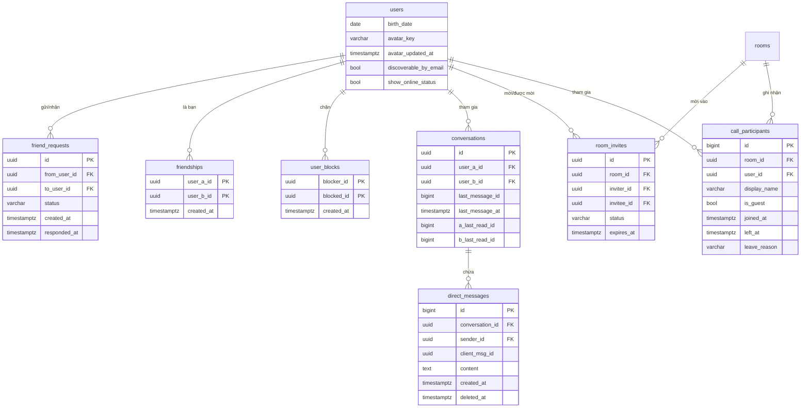

# Extend: Chức năng mở rộng

> Bổ sung cho bộ `docs/` (README, 01-09). Trạng thái: **E1–E3 đã triển khai; E4–E7 vẫn là thiết kế**. Xem [báo cáo E1](e1-report.md) và [báo cáo E2/E3](e2-e3-report.md). Yêu cầu mới ngày 20/11/2026: triển khai E2/E3 và push nhánh `feat/phase2`.
> Quy tắc làm việc giữ nguyên như cũ: thiết kế xong rồi mới code; migration tạo dần; phân tầng `api/realtime → services → models`; tài liệu là bản sống (sửa code đổi thiết kế thì sửa docs trong cùng commit).
> Giao diện của các chức năng này nằm ở `ui.md`; ý tưởng chưa chốt nằm ở `idea.md`.

## 1. Tổng quan

| Mã | Chức năng | Mô tả ngắn | Phụ thuộc |
|---|---|---|---|
| E1 | **Thông tin tài khoản** | Sửa họ tên, ngày sinh, mật khẩu, ảnh đại diện (avatar) | A2, A3 |
| E2 | **Bạn bè** | Tìm bạn bằng email, gửi/nhận lời mời, danh sách bạn, hủy kết bạn, chặn | A2, E1 |
| E3 | **Realtime theo người dùng** | Trạng thái online, thông báo lời mời kết bạn, tin nhắn, lời mời gọi | A4, E2 |
| E4 | **Nhắn tin qua bạn bè** | Chat 1-1 giữa hai người đã là bạn | E3 |
| E5 | **Mời vào cuộc gọi nhóm** | Thành viên trong phòng mời bạn bè; bạn bè bấm tham gia, không cần mật khẩu phòng | A4, E2, E3 |
| E6 | **Lịch sử cuộc gọi** | Danh sách cuộc gọi đã tham gia/chủ trì/lỡ lời mời, chi tiết, xuất nhật ký chat | A4, A8 |
| E7 | **Admin cho các chức năng trên** | Xem hồ sơ, gỡ avatar, lịch sử cuộc gọi, cấu hình | A3, A6 |

**Phạm vi:** chỉ dành cho **tài khoản đăng ký**. Khách (guest) không có bạn bè, tin nhắn, lịch sử.

**Chưa làm ở bản này** (xem `idea.md`): chat nhóm, gửi file/ảnh trong tin nhắn, thông báo đẩy khi đóng ứng dụng, đổi email, xóa tài khoản, báo cáo vi phạm.

## 2. Nguyên tắc thiết kế

1. **Riêng tư mặc định.** Không lộ email, ngày sinh, danh sách bạn của người này cho người khác.
2. **Chống dò tài khoản.** Tìm kiếm chỉ khớp **chính xác** một email, có giới hạn tần suất, và không phân biệt "không tồn tại" với "không cho tìm thấy".
3. **Chống làm phiền.** Giới hạn lời mời, từ chối thì im lặng, có chặn.
4. **Một nguồn sự thật.** Mọi trạng thái nằm trong DB; thông báo realtime chỉ là gợi ý "có thay đổi". Mất kết nối rồi nối lại thì client **gọi HTTP để đồng bộ**.
5. **Không đổi API cũ.** Chỉ **mở rộng** `/me` và `join_room`; mọi thứ khác là endpoint/sự kiện mới.
6. **Dùng lại hạ tầng có sẵn.** Auth, rate limit, audit log, settings, trạng thái RAM của Socket.io.

## 3. Mô hình dữ liệu (migration 0009 đến 0013)

### 3.1 ERD phần mới



Quy ước đặt tên: bảng `messages` đã dùng cho **chat trong phòng** (migration `0007`); tin nhắn giữa bạn bè dùng tên riêng `direct_messages` để khỏi nhầm.

### 3.2 Cột thêm vào `users` (migration `0009`)

| Cột | Kiểu | Ràng buộc | Ghi chú |
|---|---|---|---|
| `birth_date` | date | NULL, CHECK `birth_date >= '1900-01-01'` | Chỉ kiểm tra cận dưới ở DB; "không ở tương lai" kiểm tra ở service (hàm `current_date` không nên nằm trong CHECK) |
| `avatar_key` | varchar(80) | NULL | Mã băm của ảnh đã xử lý, dùng dựng đường dẫn tệp |
| `avatar_updated_at` | timestamptz | NULL | |
| `discoverable_by_email` | boolean | NOT NULL, default `true` | `false` thì không ai tìm thấy bằng email |
| `show_online_status` | boolean | NOT NULL, default `true` | `false` thì bạn bè không thấy trạng thái trực tuyến |

**Họ tên** dùng lại cột `display_name` đã có (2-50 ký tự); giao diện ghi nhãn "Họ và tên". Không thêm cột trùng ý nghĩa.

### 3.3 `friend_requests` và `friendships` (migration `0010`)

**`friend_requests`**: lịch sử các lời mời.

| Cột | Kiểu | Ràng buộc |
|---|---|---|
| `id` | uuid | PK |
| `from_user_id`, `to_user_id` | uuid | NOT NULL, FK → `users.id` ON DELETE CASCADE; CHECK `from_user_id <> to_user_id` |
| `status` | varchar(16) | NOT NULL, default `'pending'`, CHECK in (`pending`,`accepted`,`declined`,`cancelled`,`expired`) |
| `created_at`, `responded_at` | timestamptz | |

Index: UNIQUE một phần `(from_user_id, to_user_id) WHERE status = 'pending'` (không gửi trùng); `(to_user_id, status)`; `(from_user_id, status)`.

**`friendships`**: quan hệ bạn bè hiện có, **một dòng cho mỗi cặp** theo thứ tự chuẩn.

| Cột | Kiểu | Ràng buộc |
|---|---|---|
| `user_a_id`, `user_b_id` | uuid | FK → `users.id` ON DELETE CASCADE; **CHECK `user_a_id < user_b_id`**; PK `(user_a_id, user_b_id)` |
| `created_at` | timestamptz | |

Index: PK + `ix_friendships_user_b_id (user_b_id)`. Danh sách bạn của X: `WHERE user_a_id = X OR user_b_id = X`.
Service luôn sắp xếp cặp trước khi ghi (`a = min(x, y)`, `b = max(x, y)`), nhờ vậy không thể có hai dòng ngược chiều cho cùng một cặp.

**`user_blocks`**: chặn một chiều.

| Cột | Kiểu | Ràng buộc |
|---|---|---|
| `blocker_id`, `blocked_id` | uuid | FK → `users.id` ON DELETE CASCADE; CHECK khác nhau; PK `(blocker_id, blocked_id)` |
| `created_at` | timestamptz | |

Index: `(blocked_id)`.

### 3.4 `conversations` và `direct_messages` (migration `0011`)

**`conversations`**: mỗi cặp bạn bè có tối đa một cuộc trò chuyện, tạo khi gửi tin đầu tiên.

| Cột | Kiểu | Ghi chú |
|---|---|---|
| `id` | uuid | PK |
| `user_a_id`, `user_b_id` | uuid | FK CASCADE; CHECK `user_a_id < user_b_id`; **UNIQUE** `(user_a_id, user_b_id)` |
| `last_message_id` | bigint | NULL; không đặt FK để tránh vòng phụ thuộc |
| `last_message_at` | timestamptz | NULL; dùng sắp xếp danh sách |
| `a_last_read_id`, `b_last_read_id` | bigint | NOT NULL, default 0; tin có `id` lớn hơn là chưa đọc |
| `created_at` | timestamptz | |

Số tin chưa đọc của X = số tin của người kia có `id > X_last_read_id`.

**`direct_messages`**

| Cột | Kiểu | Ghi chú |
|---|---|---|
| `id` | bigint identity | PK, dùng làm con trỏ phân trang |
| `conversation_id` | uuid | NOT NULL, FK → `conversations.id` ON DELETE CASCADE |
| `sender_id` | uuid | NULL, FK → `users.id` ON DELETE SET NULL |
| `client_msg_id` | uuid | NOT NULL; **UNIQUE** `(conversation_id, sender_id, client_msg_id)`: gửi lại do mất mạng không tạo tin trùng |
| `content` | text | NOT NULL, CHECK `deleted_at IS NOT NULL OR char_length(content) BETWEEN 1 AND 2000` |
| `created_at` | timestamptz | |
| `deleted_at` | timestamptz | NULL; xóa mềm: đặt `deleted_at` **và ghi đè `content = ''`** để không còn nội dung trong DB |

Index: `ix_direct_messages_conversation_id_id (conversation_id, id DESC)`.
Khi xóa tài khoản: các `conversations` liên quan bị xóa (CASCADE), nên cả hai phía mất lịch sử. Chấp nhận ở bản này.

### 3.5 `room_invites` (migration `0012`)

| Cột | Kiểu | Ghi chú |
|---|---|---|
| `id` | uuid | PK, cũng là **mã mời** (`invite_id`) |
| `room_id` | uuid | NOT NULL, FK → `rooms.id` ON DELETE CASCADE |
| `inviter_id` | uuid | NULL, FK → `users.id` ON DELETE SET NULL |
| `invitee_id` | uuid | NOT NULL, FK → `users.id` ON DELETE CASCADE |
| `status` | varchar(16) | NOT NULL, default `'pending'`, CHECK in (`pending`,`accepted`,`declined`,`expired`,`cancelled`) |
| `created_at`, `responded_at` | timestamptz | |
| `expires_at` | timestamptz | NOT NULL, = `created_at + invite_ttl_seconds` |

Index: UNIQUE một phần `(room_id, invitee_id) WHERE status = 'pending'`; `(invitee_id, status, expires_at)`; `(room_id)`.

### 3.6 `call_participants` (migration `0013`)

Mỗi **lần vào phòng** là một dòng (vào lại thì thêm dòng mới).

| Cột | Kiểu | Ghi chú |
|---|---|---|
| `id` | bigint identity | PK |
| `room_id` | uuid | NOT NULL, FK → `rooms.id` ON DELETE CASCADE |
| `user_id` | uuid | NULL, FK → `users.id` ON DELETE SET NULL (khách hoặc user đã xóa) |
| `display_name` | varchar(50) | NOT NULL, chụp lại tên lúc vào |
| `is_guest` | boolean | NOT NULL |
| `joined_at` | timestamptz | NOT NULL |
| `left_at` | timestamptz | NULL khi còn trong phòng |
| `leave_reason` | varchar(16) | NULL; `left`, `disconnected`, `kicked`, `room_closed`, `session_replaced`, `server_restart` |

Index: `(user_id, joined_at DESC) WHERE user_id IS NOT NULL`; `(room_id, joined_at)`.

**Suy ra từ dữ liệu này:** "bắt đầu" = `min(joined_at)`, "kết thúc" = `max(left_at)`, thời lượng bạn tham gia = tổng `left_at - joined_at` của các dòng của bạn.
**Khi app khởi động lại:** mọi dòng `left_at IS NULL` đều đóng với `leave_reason = 'server_restart'`, vì trạng thái phòng trong RAM đã mất.

### 3.7 Kế hoạch migration

V2 đã dùng `0008` cho chuyển thiết bị. E1 dùng `0009` thay cho số trong bản nháp cũ; các số dự kiến phía sau dịch một bước. Chỉ `0009` được triển khai ở E1; `down_revision` của bước sau phải nối head thực tế khi triển khai, theo thứ tự đã duyệt.

| Rev | Tên | Nội dung | Bước |
|---|---|---|---|
| `0009` | `add_user_profile` | 5 cột mục 3.2 (đều có default hoặc NULL nên an toàn với dữ liệu cũ) | E1 |
| `0010` | `create_friends` | `friend_requests`, `friendships`, `user_blocks` | E2 |
| `0011` | `create_direct_messages` | `conversations`, `direct_messages` | E4 |
| `0012` | `create_room_invites` | `room_invites` | E5 |
| `0013` | `create_call_participants` | `call_participants` | E6 |

Giữ nguyên quy tắc cũ: mỗi migration một việc, đọc lại bản autogenerate, viết `downgrade()`, CI chạy `alembic check`. Index một phần (`WHERE ...`) và CHECK có hàm Alembic **không tự sinh đúng**, viết tay.

### 3.8 Việc dọn dẹp định kỳ

| Việc | Tần suất | Quy tắc |
|---|---|---|
| Hết hạn lời mời kết bạn | Mỗi giờ | `pending` quá `friend_request_ttl_days` → `expired` |
| Hết hạn lời mời gọi | Mỗi phút | `pending` có `expires_at < now()` → `expired` |
| Xóa tin nhắn cũ | Hằng ngày | Nếu `dm_retention_days > 0`: xóa `direct_messages` cũ hơn ngưỡng |
| Xóa lịch sử cuộc gọi | Hằng ngày | `call_participants` và `rooms` đã đóng cũ hơn `call_history_retention_days`. **Phòng đóng không bị xóa sớm hơn ngưỡng này**, vì khóa ngoại CASCADE sẽ kéo theo lịch sử |
| Đóng dòng tham gia treo | Khi app khởi động | Mục 3.6 |
| Dọn tệp avatar mồ côi | Hằng tuần | Tệp không còn được `users.avatar_key` tham chiếu |

## 4. E1: Thông tin tài khoản

### 4.1 Hiển thị và chỉnh sửa

| Trường | Sửa được? | Quy tắc |
|---|---|---|
| Họ và tên (`display_name`) | Có | Trim, 2-50 ký tự, loại ký tự điều khiển |
| Ngày sinh (`birth_date`) | Có | Tùy chọn; không ở tương lai; không trước 1900-01-01; không quá 120 tuổi; xóa được (`null`) |
| Mật khẩu | Có (endpoint riêng) | Như `02-api.md` mục 5: cần mật khẩu hiện tại; thành công thì thu hồi các phiên khác |
| Ảnh đại diện | Có | Mục 4.3 |
| Email | **Không** | Là định danh đăng nhập và là khóa tìm bạn; đổi email để `idea.md` |
| Quyền riêng tư | Có | `discoverable_by_email`, `show_online_status` |

Sau khi đổi tên, **phiên đang gọi giữ tên cũ** tới khi vào lại phòng (tên được chụp lúc vào). Danh sách bạn bè và tin nhắn dùng tên hiện tại. Không dùng claim `name` trong JWT để hiển thị (có thể cũ); đọc từ DB.

### 4.2 API (mở rộng `/me`)

`GET /api/v1/me` bổ sung các trường:
```json
{
  "id": "uuid",
  "email": "mailinh@example.com",
  "display_name": "Mai Linh",
  "birth_date": "2004-05-20",
  "avatar_url": "/media/avatars/<user_id>/<hash>-256.webp",
  "avatar_thumb_url": "/media/avatars/<user_id>/<hash>-64.webp",
  "role": "user",
  "is_guest": false,
  "must_change_password": false,
  "privacy": { "discoverable_by_email": true, "show_online_status": true },
  "created_at": "2026-10-01T00:00:00Z"
}
```
`avatar_url` là `null` nếu chưa có ảnh (client tự vẽ ảnh chữ cái đầu).

| Method | Path | Mô tả | Lỗi chính |
|---|---|---|---|
| PATCH | `/me` | `{ "display_name"?, "birth_date"?, "privacy"? }` (khóa vắng mặt giữ nguyên, `birth_date: null` để xóa) | 422 `VALIDATION_ERROR` / `INVALID_BIRTH_DATE` |
| POST | `/me/password` | Giữ nguyên | 400 `WRONG_PASSWORD`, `PASSWORD_UNCHANGED` |
| PUT | `/me/avatar` | `multipart/form-data`, trường `file` | 400 `INVALID_IMAGE`, 413 `IMAGE_TOO_LARGE`, 403 `FEATURE_DISABLED` |
| DELETE | `/me/avatar` | Gỡ ảnh | 204 |
| GET | `/media/avatars/{user_id}/{hash}-{size}.webp` | Tệp ảnh (tĩnh) | 404 |

Khách vẫn dùng được `GET /me` như trước (hồ sơ khách, không có các trường thành viên mới). Các thao tác PATCH hồ sơ, PUT/DELETE avatar và đổi mật khẩu trả 403 `GUEST_NOT_ALLOWED`. GET ảnh là công khai theo đánh đổi ở mục 4.3.

### 4.3 Xử lý ảnh đại diện (an toàn là chính)

Không bao giờ tin tên tệp, `Content-Type` hay phần mở rộng do người dùng gửi.

1. Đọc theo luồng, **dừng ngay khi vượt `avatar_max_kb`** (mặc định 2 MB) → 413.
2. Mở bằng thư viện xử lý ảnh (Pillow), chỉ chấp nhận định dạng **JPEG, PNG, WebP** (kiểm tra theo nội dung thực). **Không nhận SVG** (có thể chứa script).
3. Giới hạn **số điểm ảnh** (ví dụ 25 triệu) để chống ảnh "bom giải nén".
4. Áp dụng hướng xoay từ EXIF rồi **xóa mọi metadata** (EXIF có thể chứa vị trí GPS).
5. Cắt vuông ở giữa, tạo hai cỡ **256 px** và **64 px**, lưu WebP.
6. Tên tệp = băm nội dung đầu ra (`<hash>-256.webp`, `<hash>-64.webp`), ghi tạm rồi đổi tên nguyên tử; cập nhật `users.avatar_key`; xóa tệp cũ.
7. Việc xử lý chạy trong **thread pool với semaphore nhỏ** (ví dụ 2), không chặn event loop và không làm cạn RAM trên máy yếu.
8. Phục vụ với `Cache-Control: public, max-age=31536000, immutable` (tên tệp đổi khi ảnh đổi).

E1 giới hạn tổng multipart ở mức `avatar_max_kb * 1024 + 16 KB` cho boundary/header, đọc file tối đa giới hạn + 1 byte và đóng tệp tạm khi lỗi. Xác thực và kiểm tra tính năng trước khi đọc body. Chỉ sao chép pixel sang ảnh mới sau khi đã thu nhỏ, để giảm RAM. Các yêu cầu thay/gỡ ảnh được tuần tự hóa qua commit và dọn tệp trong app một worker. Nếu commit gặp lỗi không xác định kết quả, giữ tệp mới để tránh làm mất ảnh DB có thể đã tham chiếu; job dọn ảnh mồ côi vẫn thuộc phần vận hành dự kiến.

URL là bất biến theo nội dung, nên xóa trên máy chủ không thu hồi được bản đã lưu trong cache của trình duyệt.

URL ảnh **công khai nhưng không đoán được** (`user_id` + mã băm). Đây là đánh đổi có chủ ý vì thẻ `` không gửi được header `Authorization` (xem D31). Lưu tệp trên **volume Docker** (`avatars`), nằm trong phạm vi sao lưu.

## 5. E2: Bạn bè

### 5.1 Quy tắc nghiệp vụ

- Chỉ tài khoản đăng ký; hai bên phải `is_active`.
- **Tìm bằng email**, khớp **chính xác** (không tìm một phần), chỉ trả tối đa 1 kết quả.
- Người dùng chỉ tìm thấy khi `discoverable_by_email = true`, không bị chặn theo cả hai chiều, và không phải chính mình. Trường hợp không tìm thấy, **không có email đó** và **bị ẩn** cho cùng một kết quả rỗng.
- Kết quả tìm chỉ gồm `id`, `display_name`, `avatar_url`, `relationship`. **Không trả email, ngày sinh.**
- Gửi lời mời: không tự kết bạn với mình; không trùng lời mời đang chờ; không gửi lại trong **24 giờ** sau khi bị từ chối; còn hạn mức `max_pending_friend_requests` và `max_friends_per_user`.
- **Hai bên cùng mời nhau** (đã có lời mời đến từ người kia) → tự động chấp nhận.
- **Từ chối là im lặng**: người gửi không nhận thông báo, lời mời hiển thị "đã gửi" tới khi hết hạn (`friend_request_ttl_days`). Cách này tránh làm căng thẳng và quấy rối.
- **Chặn** (`block`): xóa quan hệ bạn bè, hủy lời mời kết bạn và lời mời gọi đang chờ giữa hai người, ẩn nhau khỏi tìm kiếm, không nhắn tin được. Người bị chặn **không được báo**; các thao tác nhắm vào người chặn trả lỗi chung `USER_NOT_FOUND`.
- Hủy kết bạn: xóa `friendships`; lịch sử tin nhắn **giữ lại ở chế độ chỉ đọc**, không gửi thêm được.

Chi tiết E2 đã triển khai: khóa hai dòng tài khoản theo thứ tự UUID trước mọi thay đổi quan hệ để giữ đúng hạn mức khi có yêu cầu đồng thời. Từ chối được che thành `pending` trong API của người gửi, không trả `responded_at`; lời mời bị che cũng tính vào hạn mức gửi. Hủy lời mời không vượt được cooldown 24 giờ. Gửi lại sau cooldown chỉ hiển thị lời mời mới nhất mỗi người nhận. Nếu người kia chủ động gửi ngược lại thì có thể chấp nhận ngay; lời mời cũ bị che được kết thúc để không xuất hiện lại sau khi hủy kết bạn.

Thời hạn áp dụng ngay khi đọc/chấp nhận, không cần chờ job; sweep hiện có đánh dấu lời mời `pending` quá hạn mỗi khoảng 30 giây. Lịch sử `declined` giữ mốc người nhận phản hồi để kiểm tra cooldown. Bản E2/E3 chưa có tin nhắn riêng hay lời mời gọi; phần chặn gửi DM/hủy lời mời gọi sẽ nối với E4/E5 khi các bảng đó được triển khai.

Khi `friends_enabled=false`, tìm kiếm, danh sách bạn/lời mời, gửi và chấp nhận bị chặn; hủy/từ chối, hủy kết bạn và quản lý chặn vẫn dùng được. Tìm kiếm bị giới hạn 20/phút và 200/ngày mỗi tài khoản, thêm 60/phút và 600/ngày mỗi IP. Gửi lời mời giới hạn 10/phút mỗi tài khoản và 30/phút mỗi IP.

### 5.2 API

| Method | Path | Mô tả | Lỗi chính |
|---|---|---|---|
| GET | `/users/search?email=<đầy đủ>` | Tìm một người; trả `{ "items": [ ... ] }` (rỗng hoặc một phần tử) | 422 email sai định dạng, 429, 403 `FEATURE_DISABLED` |
| POST | `/friends/requests` | `{ "to_user_id" }` → 201 | 404 `USER_NOT_FOUND`, 409 `ALREADY_FRIENDS` / `REQUEST_ALREADY_SENT`, 409 `FRIEND_LIMIT_REACHED`, 429 `REQUEST_COOLDOWN` |
| GET | `/friends/requests?direction=incoming\|outgoing` | Lời mời đang chờ | |
| POST | `/friends/requests/{id}/accept` | Chỉ người nhận | 404 `REQUEST_NOT_FOUND`, 409 `FRIEND_LIMIT_REACHED` |
| POST | `/friends/requests/{id}/decline` | Chỉ người nhận (im lặng) | 404 |
| DELETE | `/friends/requests/{id}` | Người gửi hủy lời mời | 404 |
| GET | `/friends?q=&page=&page_size=` | Danh sách bạn | |
| DELETE | `/friends/{user_id}` | Hủy kết bạn | 404 `NOT_FRIENDS` |
| GET | `/blocks` | Danh sách đã chặn | |
| POST | `/blocks` | `{ "user_id" }` | 404 |
| DELETE | `/blocks/{user_id}` | Bỏ chặn (không tự khôi phục quan hệ bạn bè) | 404 |

Ví dụ kết quả tìm kiếm:
```json
{ "items": [ { "id": "uuid", "display_name": "Mai Linh", "avatar_url": "/media/...", "relationship": "none" } ] }
```
`relationship` ∈ `none` | `friend` | `request_sent` | `request_received`.

Phần tử danh sách bạn:
```json
{ "id": "uuid", "display_name": "Mai Linh", "avatar_url": "/media/...-64.webp", "is_online": true, "since": "2026-11-01T08:00:00Z" }
```
`is_online` là `null` nếu người kia tắt `show_online_status`. Sắp xếp: trực tuyến trước, rồi theo tên.

POST lời mời trả 201 với `{id, from, to, status, created_at}` (`status` là `pending` hoặc `accepted` nếu tự chấp nhận chiều ngược). GET lời mời trả `{items:[...]}` với người gửi/nhận chỉ gồm hồ sơ công khai. Accept trả 200 với phần tử bạn bè; decline/cancel/unfriend/unblock trả 204; block trả 201 với `{user, created_at}`, gọi lại vẫn 201. GET bạn bè trả `{items,total,page,page_size}`; `page_size` 1–100.

## 6. E3: Realtime theo người dùng

Hiện tại mỗi socket chỉ vào "phòng gọi" (room Socket.io theo `code`). Thêm một room riêng theo người dùng để đẩy thông báo.

- Khi `connect` (chỉ với người dùng thật, không phải khách): `sio.enter_room(sid, "user:<user_id>")`. Mọi tab của một người đều nhận cùng thông báo.
- **Trạng thái online** lấy từ `users_online` đã có (`03-socket-events.md` mục 1.2). Một người là "online" khi có ít nhất một socket.
- **Phát `presence_changed`** cho bạn bè (có `show_online_status`) chỉ khi **socket đầu tiên kết nối** hoặc **socket cuối cùng ngắt**, và **chờ khoảng 5 giây** trước khi báo "offline" để không nhấp nháy khi mạng chập chờn.
- Server giữ **bộ nhớ đệm danh sách bạn** của người đang online (xóa khi bạn bè thay đổi) để không truy vấn DB mỗi lần phát trạng thái.
- Thông báo là **cố gắng tối đa (best-effort)**. Sau khi nối lại, client gọi: `GET /friends/requests`, `GET /invites`, `GET /conversations` rồi `GET /conversations/{id}/messages?after=<id>` để đồng bộ phần bỏ lỡ.

E3 hiện tự đồng bộ `/friends` (đủ các trang), `/friends/requests?direction=incoming` và `outgoing` khi socket web kết nối/kết nối lại. Module `client/js/friends-sync.js` được gắn vào sảnh và phòng gọi cho thành viên; thông báo cấu trúc thay đổi cũng làm mới snapshot. Kết quả phát nội bộ qua `videocall:friends-synced` cho phần UI U5 kết nối sau; lỗi đồng bộ phát `videocall:friends-sync-error`. Phản hồi của kết nối cũ bị bỏ, các lần làm mới đồng thời được gộp. Không gọi các API DM/lời mời gọi chưa có ở E4/E5.

HTTP danh sách bạn giữ trạng thái online trong khoảng chờ 5 giây giống sự kiện realtime. Tắt hiển thị online gửi `online: null` để bạn bè bỏ trạng thái cũ, sau đó không phát online/offline tới khi bật lại. Tên/ảnh thay đổi trên API người dùng hoặc sửa tên bằng admin được phát cho bạn bè; ngày sinh/email không nằm trong payload. Cache chỉ giữ cho người đang online; xóa khi quan hệ/quyền thay đổi, khi offline và khi shutdown. Khách không vào room `user:<id>`.

### 6.1 Sự kiện server → client

| Event | Dữ liệu | Gửi cho | Khi nào |
|---|---|---|---|
| `friend_request_received` | `{ request: {id, from: {id, display_name, avatar_url}, created_at} }` | Người nhận | Có lời mời mới |
| `friend_added` | `{ user }` | Cả hai | Lời mời được chấp nhận |
| `friend_removed` | `{ user_id }` | Người còn lại | Bị hủy kết bạn |
| `friend_profile_changed` | `{ user_id, display_name, avatar_url }` | Bạn bè | Đổi tên/avatar |
| `presence_changed` | `{ user_id, online: true\|false\|null }` | Bạn bè | `null` khi người dùng vừa tắt hiển thị online; mục 6 |
| `dm_message` | `{ conversation_id, message }` | Người nhận (và các tab khác của người gửi) | Có tin nhắn mới |
| `dm_read` | `{ conversation_id, by_user_id, up_to_id }` | Người kia | Đã đọc tới tin |
| `dm_typing` | `{ conversation_id, from_user_id, typing }` | Người kia | Đang nhập (tùy chọn) |
| `call_invite` | `{ invite: {id, room: {code, name, mode, has_password}, from: {...}, expires_at} }` | Người được mời | Có lời mời gọi |
| `call_invite_cancelled` | `{ invite_id, reason }` | Người được mời | Người mời hủy, phòng đóng, hết hạn |
| `call_invite_responded` | `{ invite_id, status, by_user_id }` | Người mời | Đã tham gia / từ chối |

### 6.2 Sự kiện client → server

| Event | Dữ liệu | Ack / Lỗi |
|---|---|---|
| `dm_send` | `{ to_user_id, text, client_msg_id }` | `{ ok, data: { message } }`; lỗi `NOT_FRIENDS`, `DM_DISABLED`, `INVALID_PAYLOAD`, `RATE_LIMITED` |
| `dm_read` | `{ conversation_id, up_to_id }` | `{ ok }` |
| `dm_typing` | `{ to_user_id, typing }` | Không ack; giới hạn 1 lần / 2 giây |
| `join_room` | **mở rộng:** `{ code, password?, invite_id? }` | Mục 8.2 |

## 7. E4: Nhắn tin qua bạn bè

### 7.1 Quy tắc

- Chỉ nhắn được cho người **đang là bạn**, không bị chặn theo cả hai chiều, và `dm_enabled = true`.
- Tin dài 1-2000 ký tự sau khi trim, **chỉ văn bản** (client dùng `textContent`, không `innerHTML`), không tự nhúng liên kết.
- Gửi bằng socket `dm_send` có ack; trùng `client_msg_id` thì trả lại tin đã lưu thay vì tạo tin mới.
- Cuộc trò chuyện (`conversations`) tạo ở tin đầu tiên.
- Xóa tin của chính mình: xóa mềm (mục 3.4); người kia thấy "Tin nhắn đã bị xóa".
- Sau khi hủy kết bạn hoặc chặn: **xem lại được, không gửi thêm được** (`NOT_FRIENDS`).
- Quản trị viên **không đọc được** tin nhắn riêng (xem mục 10).

### 7.2 API (lịch sử và trạng thái đọc)

| Method | Path | Mô tả |
|---|---|---|
| GET | `/conversations` | Danh sách: người kia, tin cuối (rút gọn), `unread_count`, `last_message_at`; mới nhất trước |
| GET | `/conversations/{id}/messages?before=&after=&limit=` | Lịch sử theo con trỏ (`limit` tối đa 100); `after` dùng để đồng bộ sau khi nối lại |
| POST | `/conversations/{id}/read` | `{ "up_to_id" }`: đánh dấu đã đọc (giống `dm_read`, dành cho trường hợp không có socket) |
| DELETE | `/conversations/{id}/messages/{message_id}` | Xóa tin của chính mình |
| GET | `/conversations/with/{user_id}` | Lấy cuộc trò chuyện với một người bạn (trả khung rỗng nếu chưa có) |

Lỗi: 403 `NOT_IN_CONVERSATION`, 404 `NOT_FOUND`, 403 `DM_DISABLED`.

### 7.3 Luồng gửi tin

```
A                     Server                       B (mọi tab)
|-- dm_send {to:B, text, client_msg_id} -->|
|       kiểm tra: bạn bè, chặn, độ dài, rate limit
|       lưu direct_messages (cập nhật conversation.last_message_*)
|<-- ack {ok, message} -------------------|
|                                          |-- dm_message {conv, message} --> user:B
|                                          |-- dm_message (các tab khác của A) --> user:A
|        B đọc tới tin N:
|                                          |<-- dm_read {conv, up_to_id:N} --|
|<-- dm_read {conv, by:B, up_to:N} --------|
```

## 8. E5: Mời vào cuộc gọi nhóm

### 8.1 Luồng

```
Host/thành viên (A, đang trong phòng)   Server                 Bạn (B)
 |-- POST /rooms/{code}/invites {user_ids:[B]} -->|
 |        kiểm tra: A đang ở trong phòng; B là bạn; không bị chặn;
 |        B chưa ở trong phòng; còn hạn mức; rate limit
 |        tạo room_invites (pending, hết hạn sau invite_ttl_seconds)
 |<-- 201 {sent:[...], skipped:[...]} -----------|
 |                                               |-- call_invite --> user:B
 |                                               |        B bấm "Tham gia"
 |                                               |<-- join_room {code, invite_id} --
 |                                               | kiểm tra invite, KHÔNG hỏi mật khẩu phòng
 |<-- call_invite_responded {accepted} ----------|-- ack join_room, peer_joined ... --> B
```

### 8.2 Quy tắc

- Người mời phải **đang ở trong phòng** (kiểm tra bằng trạng thái RAM).
- Chỉ mời được **bạn bè** (không mời khách, không mời người lạ).
- **Lời mời không giữ chỗ**: vẫn áp dụng giới hạn số người và `banned_user_ids` khi vào.
- Người nhận có thể **ngoại tuyến**: lời mời được lưu, hiện ra khi họ mở ứng dụng (qua `GET /invites`) nếu chưa hết hạn.
- **Phòng có mật khẩu:** `invite_id` hợp lệ cho phép vào **không cần mật khẩu**. Mã mời gắn với **đúng người được mời**, đúng phòng, còn hạn, phòng còn `active`.
- Nếu người được mời tự vào phòng bằng mã (không qua `invite_id`) thì lời mời đang chờ cũng được đánh dấu `accepted`.
- Phòng đóng, người mời hủy, hoặc bị chặn → lời mời `cancelled` và gửi `call_invite_cancelled`.
- Không mời người **đã trong phòng** (lý do `already_in_room`).
- Tối đa `max_invites_per_call` lời mời đang chờ mỗi phòng; rate limit 20 lần mời / phút / người.
- Từ chối là `POST /invites/{id}/decline` (người mời được báo `call_invite_responded: declined`; khác với lời mời kết bạn, ở đây cần phản hồi tức thời).

### 8.3 API

| Method | Path | Mô tả | Lỗi chính |
|---|---|---|---|
| POST | `/rooms/{code}/invites` | `{ "user_ids": [ ... ] }` (tối đa 20) → `{ "sent": [{user_id, invite_id}], "skipped": [{user_id, reason}] }` | 403 `NOT_IN_ROOM`, 404 `ROOM_NOT_FOUND`, 429 |
| GET | `/invites?status=pending` | Lời mời gọi đến tôi (chưa hết hạn) | |
| POST | `/invites/{id}/decline` | Người được mời từ chối | 404 `INVITE_NOT_FOUND`, 410 `INVITE_EXPIRED` |
| DELETE | `/rooms/{code}/invites/{id}` | Người mời hoặc host hủy | 403, 404 |

`reason` của `skipped`: `not_friend`, `already_in_room`, `already_invited`, `not_allowed`, `limit_reached`.
Chấp nhận lời mời **không có endpoint riêng**: client gửi `join_room { code, invite_id }` (một nơi duy nhất quyết định ai được vào phòng, như đã thống nhất ở `02-api.md`). Lỗi thêm cho `join_room`: `INVITE_INVALID`, `INVITE_EXPIRED`.

### 8.3.1 "Gọi bạn" nhanh từ danh sách bạn

Nút "Gọi" trên một người bạn là **tổ hợp của các API có sẵn**: tạo phòng (`POST /rooms`) → vào phòng → mời người đó. Không cần luồng riêng ở backend.

## 9. E6: Lịch sử cuộc gọi

### 9.1 Ghi nhận

Mỗi `join_room` thành công thêm một dòng `call_participants`; mỗi lần rời (mọi lý do) cập nhật `left_at` và `leave_reason`. Việc ghi chạy **nền**, không chặn luồng realtime.

### 9.2 Hiển thị

Một mục lịch sử = một **phòng** mà bạn từng ở trong đó, hoặc một lời mời bạn đã lỡ:

| `type` | Điều kiện |
|---|---|
| `hosted` | Bạn là chủ phòng (`rooms.host_id`) và có tham gia |
| `joined` | Bạn tham gia nhưng không phải chủ phòng |
| `missed_invite` | Lời mời gọi gửi cho bạn hết hạn mà bạn không phản hồi |

### 9.3 API

| Method | Path | Mô tả |
|---|---|---|
| GET | `/me/call-history?type=&from=&to=&page=&page_size=` | Danh sách, mới nhất trước |
| GET | `/me/call-history/{room_code}` | Chi tiết: người tham gia, mốc vào/ra |
| GET | `/me/call-history/{room_code}/chat-export` | Tải nhật ký chat của phòng (`text/plain`), chỉ khi bạn từng tham gia và chat còn lưu |
| DELETE | `/me/call-history` | Xóa lịch sử của riêng tôi: gỡ liên kết `user_id` khỏi các dòng `call_participants` của tôi (tên đã chụp vẫn hiển thị với người khác) |

Phần tử danh sách:
```json
{
  "room_code": "abc-defg-hij",
  "name": "Họp nhóm",
  "type": "hosted",
  "started_at": "2026-11-15T08:30:00Z",
  "ended_at": "2026-11-15T09:08:30Z",
  "duration_seconds": 2310,
  "my_duration_seconds": 2100,
  "participants_count": 4,
  "participants_preview": [ { "display_name": "Mai Linh", "avatar_url": "/media/..." } ],
  "chat_available": true
}
```
Chi tiết thêm `participants: [ { display_name, is_guest, joined_at, left_at, leave_reason } ]`.

**Giới hạn trung thực:** chat chỉ xuất được trong thời hạn lưu `chat_retention_days` (mặc định 30 ngày, ngắn hơn lịch sử 90 ngày). Sau đó `chat_available = false`. "Transcript giọng nói" **không có** ở bản này (xem `idea.md`).

## 10. Quyền riêng tư và bảo mật

### 10.1 Ai thấy gì

| Dữ liệu | Chính chủ | Bạn bè | Người tìm bằng email | Người trong cùng phòng | Admin |
|---|---|---|---|---|---|
| Email | Có | Không | Đã biết (họ nhập) | Không | Có |
| Họ tên, avatar | Có | Có | Có | Có (tên) | Có |
| Ngày sinh | Có | **Không** | Không | Không | Có |
| Trạng thái online | Có | Có (nếu bật) | Không | Không | Có (số liệu tổng) |
| Danh sách bạn | Có | **Không** | Không | Không | Không |
| Tin nhắn riêng | Có | Chỉ người trong cuộc | Không | Không | **Không** |
| Lịch sử cuộc gọi | Có | Không | Không | Không | Có (cấp phòng) |

### 10.2 Các mối đe dọa chính và cách giảm

| Rủi ro | Cách giảm |
|---|---|
| Quét email hàng loạt để dò tài khoản | Khớp chính xác, 20 lần / phút và 200 lần / ngày / người dùng, giới hạn theo IP, kết quả rỗng giống nhau cho "không có" và "ẩn" |
| Spam lời mời kết bạn / gọi | Hạn mức đang chờ, cooldown 24 giờ sau khi bị từ chối, rate limit, chặn, từ chối im lặng |
| Tin nhắn chứa mã độc (XSS) | Chỉ hiển thị bằng `textContent`; không HTML; không tự nhúng liên kết |
| Tải ảnh độc hại | Mục 4.3: xác thực nội dung, không SVG, giới hạn kích thước và số điểm ảnh, xóa EXIF, mã hóa lại |
| Dùng `invite_id` của người khác | Mã mời gắn `invitee_id`; kiểm tra khớp người dùng của socket |
| Lộ avatar | URL không đoán được; không chứa thông tin cá nhân; ảnh đã xóa metadata |
| Quấy rối sau khi hủy kết bạn | Chặn; không gửi được tin sau khi không còn là bạn |
| Tài khoản bị khóa vẫn nhận thông báo | Khóa tài khoản ngắt mọi socket (đã có), thu hồi lời mời đang chờ |

Mọi thao tác ghi ở mục này kiểm tra quyền **ở service**, không tin dữ liệu từ client; log không ghi nội dung tin nhắn.

## 11. Admin (E7)

Bổ sung vào `02-api.md` mục 8:

| Method | Path | Mô tả |
|---|---|---|
| GET | `/admin/users/{id}` | Mở rộng: họ tên, ngày sinh, avatar, số bạn, số cuộc gọi đã tham gia, thời điểm gần nhất |
| DELETE | `/admin/users/{id}/avatar` | Gỡ avatar vi phạm → audit `user.avatar_remove` |
| GET | `/admin/call-history?from=&to=&host=&page=` | Các cuộc gọi đã kết thúc: phòng, chủ phòng, số người, thời lượng |
| GET | `/admin/call-history/{room_code}` | Chi tiết người tham gia |

- `GET /admin/dashboard` thêm `calls_today`, `call_minutes_today`, `friend_requests_pending`.
- Danh sách `action` audit thêm: `user.avatar_remove`.
- **Admin không có API đọc tin nhắn riêng.** Nếu sau này có báo cáo vi phạm (`idea.md`), chỉ tin nhắn bị báo cáo mới được xem, và việc xem phải ghi audit.
- Admin vẫn không sửa được ngày sinh hay mật khẩu của người dùng (mật khẩu chỉ reset theo luồng sẵn có).

## 12. Cấu hình mới (bổ sung `04-settings.md` mục 3)

| Khóa | Kiểu | Mặc định | Khoảng hợp lệ | Áp dụng | Mô tả |
|---|---|---|---|---|---|
| `friends_enabled` | bool | `true` | | Ngay | Bật/tắt bạn bè (ẩn giao diện) |
| `friend_search_enabled` | bool | `true` | | Ngay | Cho phép tìm bằng email |
| `max_friends_per_user` | int | `200` | 10-2000 | Lời mời/chấp nhận mới | Số bạn tối đa |
| `max_pending_friend_requests` | int | `50` | 5-500 | Lời mời mới | Số lời mời đang chờ tối đa mỗi người gửi |
| `friend_request_ttl_days` | int | `30` | 1-365 | Job dọn dẹp | Lời mời hết hạn sau số ngày |
| `dm_enabled` | bool | `true` | | Tin nhắn mới | Bật/tắt nhắn tin |
| `dm_retention_days` | int | `0` | 0-3650 | Job dọn dẹp | `0` = không tự xóa |
| `invite_ttl_seconds` | int | `600` | 30-3600 | Lời mời mới | Thời hạn lời mời gọi |
| `max_invites_per_call` | int | `20` | 1-50 | Lời mời mới | Số lời mời đang chờ tối đa mỗi phòng |
| `call_history_enabled` | bool | `true` | | Lần vào phòng mới | Ghi và hiển thị lịch sử |
| `call_history_retention_days` | int | `90` | 7-730 | Job dọn dẹp | Số ngày giữ lịch sử |
| `allow_avatar_upload` | bool | `true` | | Ngay | Cho phép tải ảnh đại diện |
| `avatar_max_kb` | int | `2048` | 100-5120 | Lần tải mới | Kích thước ảnh tối đa |

Phần công khai cho client (`/config/public`) thêm: `friends_enabled`, `dm_enabled`, `call_history_enabled`, `allow_avatar_upload`, `avatar_max_kb`.

Hai khóa `allow_avatar_upload` và `avatar_max_kb` được đưa vào E1. Năm khóa bạn bè (`friends_enabled`, `friend_search_enabled`, hai hạn mức và TTL) được đưa vào E2 vì service cần dùng ngay, nằm trong nhóm `access`. Public config trả hai cờ bạn bè. Các khóa DM/lời mời/lịch sử và phần quản trị mở rộng vẫn chờ E4–E7. Hai quyền riêng tư được thực thi ở E2/E3.

**Hằng số trong code:** độ dài tin 1-2000; cooldown sau khi bị từ chối 24 giờ; tìm kiếm 20/phút và 200/ngày; `dm_send` 10 tin / 10 giây; mời gọi 20 lần / phút; `dm_typing` 1 lần / 2 giây; tối đa 20 người mỗi lần mời; giới hạn điểm ảnh 25 triệu.

## 13. Mã lỗi mới (bổ sung bảng ở `02-api.md` mục 9)

| HTTP / socket | Code | Ý nghĩa |
|---|---|---|
| 404 | `USER_NOT_FOUND` | Không tồn tại, ẩn hoặc bị chặn (cố ý không phân biệt) |
| 409 | `ALREADY_FRIENDS`, `REQUEST_ALREADY_SENT`, `FRIEND_LIMIT_REACHED` | |
| 404 | `REQUEST_NOT_FOUND`, `INVITE_NOT_FOUND` | |
| 429 | `REQUEST_COOLDOWN` | Chưa hết 24 giờ sau khi bị từ chối |
| 403 | `NOT_FRIENDS`, `DM_DISABLED`, `NOT_IN_CONVERSATION`, `FEATURE_DISABLED` | |
| 410 | `INVITE_EXPIRED` | Lời mời đã hết hạn |
| socket | `INVITE_INVALID` | `invite_id` sai người/phòng hoặc đã dùng |
| 400 | `INVALID_IMAGE` | |
| 422 | `INVALID_BIRTH_DATE` | Ngày sinh ngoài khoảng hợp lệ |
| 413 | `IMAGE_TOO_LARGE` | |

## 14. Hạ tầng

- Thêm volume `avatars` cho container `app`; mount vào đường dẫn dữ liệu của app; Caddy (cổng công khai) hoặc app phục vụ `/media/avatars/*`. Cổng công khai **phải cho qua** đường dẫn này (khác với `/admin` và `/metrics` bị chặn).
- Sao lưu: thêm thư mục `avatars` vào quy trình backup (`05-deployment.md` mục 8, `09-homelab-deployment.md` mục 8.3), cùng với `pg_dump`.
- RAM: xử lý ảnh dùng semaphore 2 và giới hạn điểm ảnh để không làm cạn bộ nhớ trên máy 1 GB.
- Các job mục 3.8 chạy trong cùng process bằng bộ lập lịch nội bộ (mức độ học tập), hoặc cron gọi lệnh CLI (`python -m app.cli maintenance`). Chọn cron + CLI nếu muốn tách việc nền khỏi tiến trình `--workers 1`.
- Metric mới: `friend_requests_total`, `dm_messages_total`, `call_invites_total{status}`, `avatar_uploads_total{result}`, `presence_online_users`.

## 15. Kiểm thử

| Loại | Nội dung |
|---|---|
| Unit | Sắp xếp cặp bạn bè (`a < b`), quy tắc tự chấp nhận khi hai bên cùng mời, tính số tin chưa đọc, kiểm tra hợp lệ ngày sinh, xử lý ảnh (đầu vào sai, quá lớn, quá nhiều điểm ảnh, SVG bị từ chối, EXIF bị xóa) |
| Integration (API) | Luồng kết bạn đầy đủ; tìm kiếm không lộ email ẩn; chặn xóa quan hệ và lời mời; giới hạn hạn mức; cooldown; lịch sử cuộc gọi sau một cuộc gọi giả lập; xuất chat chỉ cho người từng tham gia |
| Integration (socket) | Hai client A, B: `dm_send` → B nhận `dm_message`, `dm_read` phản hồi; `client_msg_id` trùng không tạo tin trùng; mời gọi → `call_invite` → `join_room` với `invite_id` bỏ qua mật khẩu; `invite_id` của người khác bị từ chối; khóa tài khoản ngắt socket và hủy lời mời; presence không nhấp nháy khi ngắt/nối nhanh |
| Bảo mật | Thử `PATCH /me` với trường lạ, tải tệp giả ảnh, truy cập hội thoại của người khác, đoán `invite_id` |
| Thủ công | Hai thiết bị: kết bạn, nhắn tin, mời gọi, nhận lời mời khi đang ở màn hình khác (xem `08-cross-device-testing.md`) |

## 16. Lộ trình

| Bước | Nội dung | Migration | Làm sau |
|---|---|---|---|
| E1 | Hồ sơ và avatar | `0009` | A3 |
| E2 | Bạn bè, tìm kiếm, chặn (HTTP) | `0010` | E1 |
| E3 | Realtime theo người dùng, trạng thái online, thông báo kết bạn | | A4, E2 |
| E5 | Mời vào cuộc gọi nhóm | `0012` | A4, E3 |
| E6 | Lịch sử cuộc gọi | `0013` | A4 (và A8 để xuất chat) |
| E4 | Nhắn tin qua bạn bè | `0011` | E3 |
| E7 | Admin và cấu hình | | A6 |

Thứ tự đề xuất: **hoàn thành MVP (A1-A9) rồi mới làm E1 → E2 → E3 → E5 → E6 → E4 → E7**. E1 có thể làm sớm hơn nếu muốn có giao diện hồ sơ. Các bước E không chặn B1-B7.

## 17. Tài liệu khác cần cập nhật

| File | Cập nhật |
|---|---|
| `docs/README.md` | Phạm vi (mục 2), lộ trình thêm E1-E7, bảng công nghệ không đổi |
| `docs/01-database.md` | Thêm 5 cột `users`, 7 bảng mới, ERD, migration `0009`-`0013`, việc dọn dẹp |
| `docs/02-api.md` | Mở rộng `/me`; thêm các nhóm endpoint mục 4-9 và 11; mã lỗi mục 13; rate limit |
| `docs/03-socket-events.md` | Room `user:<id>`, sự kiện mục 6, mở rộng `join_room` (`invite_id`), ghi `call_participants` khi vào/ra |
| `docs/04-settings.md` | Cấu hình mục 12 |
| `docs/05-deployment.md` | Volume `avatars`, job nền, backup, route `/media` |
| `docs/06-decisions.md` | D25-D32 và Q12-Q17 ở mục 18 |
| `AGENT_PROMPT.md` | Thêm câu lệnh bước E1-E7 (mục 19) |

## 18. Quyết định mới và câu hỏi còn mở

### Quyết định (đề xuất ghi vào `06-decisions.md`)

| ID | Quyết định | Lý do |
|---|---|---|
| D25 | Bạn bè dùng 3 bảng: `friend_requests` (lịch sử), `friendships` (một dòng mỗi cặp, `a < b`), `user_blocks` (một chiều) | Tách "lời mời" và "quan hệ"; cặp chuẩn hóa chống dòng trùng ngược chiều; chặn là hành vi một chiều |
| D26 | Tìm kiếm khớp email **chính xác** + tùy chọn `discoverable_by_email` + kết quả không phân biệt "không có" và "ẩn" | Chống dò email, chống thu thập danh sách người dùng |
| D27 | Từ chối lời mời kết bạn **im lặng**; từ chối lời mời gọi **có phản hồi** | Kết bạn không cấp bách và tránh xung đột; mời gọi cần phản hồi tức thời cho người mời |
| D28 | Tin nhắn riêng: mỗi cặp một cuộc trò chuyện; gửi qua socket có ack + `client_msg_id` chống trùng; lịch sử qua HTTP; admin không đọc được | Độ tin cậy khi mạng chập chờn; quyền riêng tư |
| D29 | Lời mời gọi lưu trong DB, `invite_id` cho phép vào phòng có mật khẩu mà không cần nhập mật khẩu | Bạn bè được mời không phải biết mật khẩu; vẫn có kiểm soát (gắn đúng người, hết hạn) |
| D30 | Lịch sử cuộc gọi suy ra từ `call_participants` (mỗi lần vào một dòng) + `rooms`; khi khởi động đóng các dòng treo | Có đủ dữ liệu cho thời lượng và người tham gia; chịu được restart (trạng thái phòng ở RAM) |
| D31 | Avatar lưu trên volume cục bộ, xử lý phía server, URL công khai không đoán được, không nhận SVG | Đơn giản, chạy được ở môi trường $0; thẻ `` không gửi được `Authorization` |
| D32 | Room Socket.io `user:<id>` cho thông báo; presence dựa trên `users_online`, trì hoãn ~5 giây trước khi báo offline | Một kênh cho mọi tab; tránh nhấp nháy |

### Câu hỏi còn mở

| # | Câu hỏi | Đề xuất | Cần chốt trước |
|---|---|---|---|
| Q12 | Có cho đổi email không? Nếu có thì xác minh bằng cách nào (cần gửi email) | E1 dùng mặc định: không đổi email; chờ nghiệm thu | E1 |
| Q13 | Ngày sinh có bắt buộc hoặc có độ tuổi tối thiểu không? | E1 dùng mặc định: tùy chọn, không có tuổi tối thiểu; kiểm tra ngày hợp lệ trong 120 năm; chờ nghiệm thu | E1 |
| Q14 | Tin nhắn riêng lưu vô thời hạn hay có thời hạn? | `dm_retention_days = 0` (vô thời hạn), admin chỉnh được | E4 |
| Q15 | Người bị chặn có còn thấy/ở cùng phòng với nhau được không? | Cho phép (không thể ngăn trong phòng công khai), chỉ chặn nhắn tin/mời/tìm kiếm | E2 |
| Q16 | Lưu avatar: volume cục bộ hay dịch vụ lưu trữ ngoài? | E1 dùng mặc định: volume cục bộ; chờ nghiệm thu | E1 |
| Q17 | Có cần thông báo đẩy khi đóng ứng dụng (đặc biệt lời mời gọi)? | Để `idea.md`; bản này chỉ thông báo khi đang mở ứng dụng | Sau E5 |

## 19. Câu lệnh gợi ý cho agent (bổ sung phần 2 của `AGENT_PROMPT.md`)

| Bước | Câu lệnh |
|---|---|
| E1 | `Thực hiện bước E1 theo docs_v3/extend.md mục 3.2 và 4: migration 0009, mở rộng GET/PATCH /me, PUT/DELETE /me/avatar với xử lý ảnh an toàn, phục vụ /media/avatars. Trình bày kế hoạch trước.` |
| E2 | `Thực hiện bước E2 theo extend.md mục 3.3 và 5: migration 0010, tìm kiếm email chính xác, lời mời kết bạn, danh sách bạn, chặn, rate limit, test không lộ email ẩn. Trình bày kế hoạch trước.` |
| E3 | `Thực hiện bước E3 theo extend.md mục 6: room user:<id>, presence có trì hoãn, sự kiện kết bạn, bộ nhớ đệm danh sách bạn, đồng bộ sau khi nối lại. Trình bày kế hoạch trước.` |
| E5 | `Thực hiện bước E5 theo extend.md mục 8: migration 0012, POST /rooms/{code}/invites, GET /invites, mở rộng join_room với invite_id, hết hạn lời mời, test invite của người khác bị từ chối. Trình bày kế hoạch trước.` |
| E6 | `Thực hiện bước E6 theo extend.md mục 3.6 và 9: migration 0013, ghi call_participants khi vào/ra, đóng dòng treo khi khởi động, API lịch sử, xuất chat. Trình bày kế hoạch trước.` |
| E4 | `Thực hiện bước E4 theo extend.md mục 3.4 và 7: migration 0011, dm_send có ack và client_msg_id, dm_read, lịch sử theo con trỏ, xóa mềm. Trình bày kế hoạch trước.` |
| E7 | `Thực hiện bước E7 theo extend.md mục 11 và 12: API admin mở rộng, cấu hình mới trong SettingsSchema, audit user.avatar_remove. Trình bày kế hoạch trước.` |
